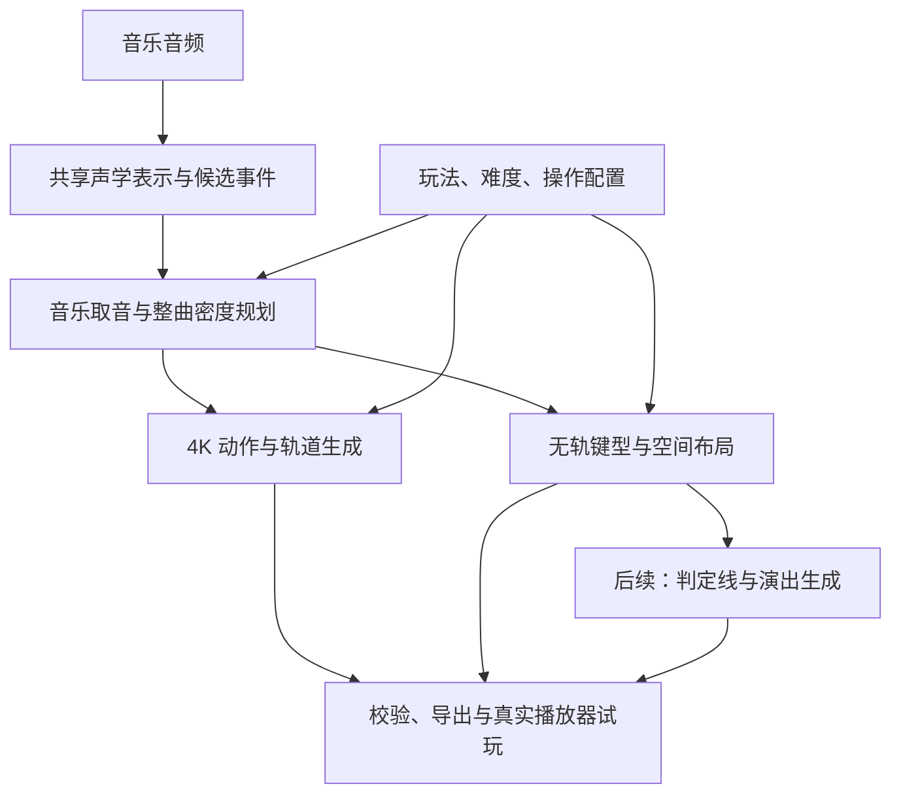

# AudioLab：产品定义与技术方案讨论稿

更新日期：2026-10-17。本文覆盖旧 README，作为本次讨论的持续记录及下一会话的开发交接入口。旧说明保留在 Git 历史，实验档案保留在 `docs/`。

**用户已授权产品设计与产品开发两个 agent 持续协作，推进完整成谱流程。设计 agent 维护需求并独立审查，开发 agent 在隔离工作区实现和修复，主会话协调资源与用户决定。** 本地上传、自动时基候选、双模式整曲生成、音频同步预览和导出的工程链路已通过独立检查；继续推进模型质量、真实试玩与动态演出。完整方案中的待决项仍未自动获批。“已确认”来自用户明确要求；“建议”是候选方案；“待定”不得解释为已接受。验收矩阵、阶段状态和恢复入口见 [交付与协作记录](docs/product_delivery.md)。

## 1. 产品开发规范

### 1.1 已确认的产品方向

| 项目 | 已确认要求 |
| --- | --- |
| 产品目标 | 定轨和无轨都产出可用模型与谱面 |
| 首版工作流 | **先实现快速成谱，后续再实现编辑工作流** |
| 定轨键型 | 4K 保留 Tap / Drag / Hold / Flick 四种键型 |
| 开发路径记录 | 定轨与无轨分别记录阶段、交付物和验收条件；共享依赖单列 |
| 音乐对应 | 音符应与音频特征对应，不能只追求密度或键型比例 |
| Hold | 数量不是绝对标准；必要时可在后续专项训练中完善 |
| 多指 | 多指属于正常玩法，不用统一双指上限定义可玩性 |
| 分支 | 各模型分别开发；最终 `main` 稳定版包含全部模型代码 |
| 资源与交付 | 控制存储、内存和显存；经验证的更新同步 GitHub |
| 当前协作 | 原先仅讨论的阶段已结束；两个 agent 分工设计／审查与实现，持续配合推进完整流程 |

讨论暂沿用音游制谱的产品方向。钢琴转谱是算法与工程参考，尚未提出新增五线谱产品的要求。

### 1.2 首版用户流程建议

选择音乐 → 选择玩法与难度 → 自动生成整首谱面 → 同步音频预览／进入指定播放器试玩 → 导出。

建议首版暴露玩法、难度、操作配置和重新生成；模型阈值与采样策略保留为开发参数。失败或超出支持范围时明确说明，不把空谱、截断谱或错时谱当作成功。

建议以“无需逐音修改即可获得可用结果”为首版验收方向。用户目前确认的是快速成谱优先，尚未确认内置播放器、网页部署、导出格式和速度时限。

当前已有本地网页入口与 CLI：选择 WAV／OGG 和玩法即可生成，BPM 可留空使用未校准的算法估计，也可手动覆盖；不可估计时明确要求补充速度，不静默填 120。结果提供独立音频同步视觉预览和 Phigros v3 JSON 导出。`ea963c9` 已通过三首整曲双模式对照和真实浏览器上传／生成／取消／失败重试／导出检查；运行说明见[对应提交的产品入口文档](https://github.com/LtePrince/AudioLab/blob/ea963c9/docs/product_pipeline.md)。这些是当前工程选择与样例证据，尚不代表目标播放器、音乐性或手感通过。自动速度存在半／倍速歧义，free-x 仍是静态单线；动态演出分别验收。

后续编辑工作流再提供逐音修改、局部重生成、时间校准、难度调整和演出编辑。首版内部结构保留音符 ID、时间、配置和版本，便于衔接。

### 1.3 待确定的产品边界

| 决策 | 当前状态 | 影响 |
| --- | --- | --- |
| 四键型的输入与判定语义 | 已确认保留四种键型；具体设备、输入映射与目标播放器规则待定 | Drag／Flick 判定、Hold 占用、动作冲突与格式适配 |
| 无轨首版是基础玩法还是包含动态演出 | 待定；建议分阶段交付，保留完整演出目标 | 数据与试玩范围 |
| 首批音乐类型 | 待定；建议先覆盖节拍相对稳定的常规混音，钢琴与自由速度单独分层评估 | 数据分布和节奏建模 |
| 曲长与格式 | 待定；候选为 WAV/MP3、1–5 分钟整曲 | 推理预算与长序列处理 |
| 使用端与运行端 | 待定：本地工具、网页加服务器或纯浏览器 | 部署、延迟与资源 |
| 导入／游玩的目标程序及版本 | 待定；输出 Phigros 风格 JSON 不等于已验证兼容 | 格式适配与验收 |
| 难度与操作配置 | 待定；建议玩法内定义难度档，手数／设备配置与难度分开 | 条件学习和玩家分组 |

定轨产品确定为四个固定位置、保留 Tap / Drag / Hold / Flick；不将键型缩减为单击与长按。现有代码已包含这些键型，但其动作检查仍需按目标播放器的真实判定语义核对。free-x 当前是静态单判定线自由横坐标，不等于完整 Phigros 多线演出。

### 1.4 开发与实验规范

1. **先写验收，再做实验。** 写清用户问题、假设、对照、数据划分、预算与退出条件；训练跑通不等于产品可用。
2. **统一时间。** 明确音频秒、节拍、tick 和 offset；导入、训练、解码、导出与播放可追溯。当前常 BPM 约定：`audio_seconds = tick * 60 / (32 * bpm) + offset`。变速需显式 tempo map，不套用单一 BPM。
3. **保留真实标签。** 不用统一双指规则清洗所有谱面，不以 Hold 比例、官谱音符数或密度替代音乐对应。派生简化谱与原始谱分开记录。
4. **模型与后处理分别报告。** 保留原始输出、合法解码输出、最终导出及修改原因；删音、移位、截短后的收益不归为模型学习收益。
5. **分清规则职责。** 格式和时间合法性由校验保证；动作与音乐设计通过条件学习改善；手数与设备限制依赖明确配置。工程分配成功不等于人类觉得好玩。
6. **按音乐来源划分数据。** 排查同曲不同难度、重编码、剪辑及近重复音频泄漏；训练、开发验证、冻结测试按曲／来源分组。已有 30 首验证集参与过开发，不是未见测试集。
7. **保证复现。** 记录提交、权重哈希、数据清单、特征版本、随机种子、推理和后处理配置；保留逐曲结果、失败案例及按歌曲重采样的区间。
8. **资源先核算。** 优先复用缓存、冻结编码器和小规模消融，不因调研下载完整 AMT 数据集。沿用资源保护，启动前检查磁盘／RAM／显存，有限保留检查点。当前磁盘余量约 12 GiB；8 GiB 保留线是现有运行保护，不能全部用于实验。
9. **验证与来源。** 小样本功能检查后执行完整冻结评估；数据、缓存、权重与生成输出不进 Git。引入模型时核查代码、权重、数据来源和运行兼容性；商业产品未公开架构不写成事实。

### 1.5 分支与交付

| 分支 | 职责 |
| --- | --- |
| `main` | 全部模型的稳定集成版本 |
| `develop` | 已验证变更的开发集成 |
| `feature/variable-length-inference` | 4K 扩散路线 |
| `feature/transcription-baseline` | 音频表示、事件检测与共享转录模块 |
| `feature/4k-generation` | 定轨布局与生成 |
| `feature/freeform-gameplay` | 无轨玩法与后续演出 |
| `chore/product-pipeline` | 本地任务、双模式流程、预览和导出的共享工程闭环 |
| `docs/product-design-discussion` | 产品要求、讨论状态、独立审查与协作交接；文档提交不代表候选指标获批 |

模型分支 → `develop` → `main`。共享修复独立提交并验证两条路线；推送不重写历史。详见 [AGENTS.md](AGENTS.md)。最新用户授权允许双 agent 持续实现和审查；训练和模型发布仍依照数据、资源、验证与分支规范，不因工程链路跑通就合入稳定版。

## 2. 产品具体指标

### 2.1 先定义“可用”

建议定义：在声明的音乐范围、玩法、难度和设备条件下，成功导入并完整播放，主要击打对应音乐，布局可读、动作合理，无需先逐音修复才能正常体验。

证据分为程序可运行、工程检查通过、目标玩家认可。自动播放视频不能代替手感评估；接触点算法只证明其假设下存在分配，不能代替实际试玩。

### 2.2 首轮候选验收表——全部数值待确认

以下用于讨论和试测，**不是现有成绩、论文标准或用户承诺**。先测基线和小规模试玩，再冻结验收版本。

| 维度 | 测量方式 | 候选目标／待定项 |
| --- | --- | --- |
| 成谱成功率 | 支持范围内生成、校验、导入、完整播放均成功的任务数 / 全部有效任务数；超时、崩溃计失败 | ≥95%；文件存在不算成功 |
| 等待时间 | 接收完整文件至可预览；分别报告冷／热启动 P50、P95 及排队耗时 | 3 分钟歌曲热启动 P95 ≤60 秒；固定硬件、模式和并发后才生效 |
| 整曲覆盖 | 核对全曲边界，检查尾段截断、拼接重复和漏段 | 静默截断为 0；允许音乐性留白，不要求全程有音符 |
| 导出合法性 | 对所有成功输出检查目标格式与时间 | 结构、越界时间、非法时长等硬错误为 0；动作冲突按最终玩法定义 |
| 可直接游玩率 | 每谱 3 名对应难度玩家完整试玩；至少 2 人认为无需逐音修正可正常游玩且无阻断问题 | 初期 ≥80%；报告谱面级比例、样本量和分歧 |
| 音乐对应／手感／可读性 | 匿名随机排序，分项 1–5 分；3=能完成但问题明显，4=基本自然、偶有瑕疵，5=连贯且愿意重玩 | 三项逐曲中位分均 ≥4 的谱面占比建议 ≥80%，不以总平均掩盖差曲 |
| 修正负担 | 记录必须删、移、改时值的音符和重做片段，可用外部工具评估 | 先收集修改音符比例、每分钟音频的修改分钟数，再定门槛 |
| 难度可控性 | 同曲高低档盲测排序，结合 1 秒／5 秒峰值密度、连续动作、Hold 占用和视觉负担 | 候选排序一致率 ≥80%；不能仅看音符数 |
| 资源 | 固定设备报告进程峰值 RAM、GPU 峰值、临时磁盘增量与任务后回收 | 数值待部署方案；不能发生 OOM、写满磁盘或无限排队 |

建议先用 10–12 首分层曲目试测量表，再让两条路线分别在至少 30 首冻结曲目上评估，覆盖曲风、密度、弱拍、长条和复杂段落。每谱 3 人仅是初期建议，不代表统计充分；按完整歌曲抽样，不只展示优选片段。正式冻结曲目须与反复使用的开发验证曲分开。

### 2.3 算法诊断指标

| 指标 | 定义与用途 | 解释限制 |
| --- | --- | --- |
| 唯一起点 P/R/F1 | 同刻事件按声明精度去重；在 ±25ms、±50ms 下分别一对一匹配 | 官谱取音不是全部声学事件，合理新编排也可能不同 |
| 时间偏差 | 已匹配事件的有符号偏差、中位绝对误差、P95；同时报告漏检与误检 | 只看匹配部分会掩盖缺失，必须配合 P/R |
| 整谱音符 F1 | 保留同刻多个音符，明确匹配规则与容差 | 与唯一起点 F1 不同；删多押可能涨分却损害表现 |
| 布局／键型 | 同轨、自由位置容差、键型和时长分别评估 | 单张参考谱不是唯一合理布局 |
| 音乐证据 | 抽样标注对应鼓点、旋律、重音或装饰，分析异常空段与密集段 | 不要求所有音乐起点都变成游戏音符 |
| 条件有效性 | 同音频换难度／操作配置；固定条件替换或打乱音频 | 检查模型是否依赖音频，不代替体验 |
| 修复负担 | 原始与最终输出的删音、移位、改时、Hold 截短数量和幅度 | 后处理达标不表示模型学会了约束 |
| 演出质量 | 动态前后击打时刻、判定时位置与可见性、运动连续性、遮挡；玩家评判音乐呼应 | 动态阶段启用，不仅检查坐标范围 |

候选协议采用最大数量的一对一时间匹配，固定边界和去重规则；历史脚本若使用不同实现，须版本化、重算对照，不拼接新旧分数。音频对齐与音乐性人工标注也须写清容差和判定标准。

AMT 常用指标同时要求音高和起点匹配，可另加结束时间要求。`mir_eval.transcription` 默认起点容差 50ms、音高 50 cents，结束容差取参考时长的 20% 与 50ms 中较大者。这是工具默认定义，**不是音游判定窗口或产品标准**。[官方指标文档](https://mir-eval.readthedocs.io/latest/api/transcription.html)

### 2.4 音频理解模型：输出、标签与指标

本节是共享模块 S2 的产品定义。工程实现已在 `feature/transcription-baseline` 提交 `2965310`，支持版本化事件与连续特征、审核区域监督、分块推理和独立评价；现有权重仍是谱面起点监督，声学质量未验收。详见该提交的 [实现说明](https://github.com/LtePrince/AudioLab/blob/2965310/docs/audio_understanding.md)。后续任务头与候选数值仍需对应数据和验证。首版目标是为定轨、无轨提供可靠的音乐事件与时间上下文，而非先完整还原所有乐器的 MIDI。玩法、难度决定的取音与四键型安排在下游分别学习。

**现有实现的实际含义：** [TranscriberNet](src/models/transcriber.py) 使用卷积与双向 Transformer 编码 mel，原输出头预测四轨起点、Hold 状态、时间微偏移和键型；这些包含谱面编排信息。[全局节奏头](src/train_rhythm.py) 预测去重后的谱面起点及帧内时间偏移，监督来自已有游戏谱面，未独立监督全部声学起音、beat／downbeat 或段落。这里 `offset` 指帧内时间偏移，不是声学音符结束时间；也不同于谱面全局 offset。

建议模型接口：`音频 → 共享编码器 → 时序特征 + 事件概率／时间精修`。在获得可信标签后，再加入节拍／小节首拍等任务头；保留连续时序特征供下游使用，避免一次阈值筛选永久丢掉弱音。优先复用现有编码器，先训练头部、再按收益决定是否微调；不先替换整个网络。

| 能力及优先级 | 模型输出 | 监督来源与指标 |
| --- | --- | --- |
| 重要声音事件，首版优先 | 可听辨的起音／重音候选、置信度、精确音频时间 | 人工审核的声音事件标注；事件级 Precision、Recall、F1 @25ms／50ms，另报误报次数／分钟 |
| 时间精度，首版优先 | 候选事件的帧内微偏移 | 审核过的音频时间；有符号偏差、绝对误差中位数／P95，同时报漏检与误检 |
| 节拍与小节首拍，下一优先级 | beat、downbeat 时间及置信度，局部速度上下文 | 经审核的拍点序列；Beat F1、Downbeat F1 分开统计，另报节拍连续性 CMLt 和半速／倍速错误 |
| 持续／旋律信息，按收益引入 | 持续区间、可选音高／音高变化特征 | 独立声学标注；区间重叠 IoU、起止误差，音高任务另报转录指标；不以游戏 Hold 标签冒充声学持续标签 |
| 音乐段落，后续增强 | 段落边界、局部强弱与重复关系 | 有标注才评价边界 F1（例如 ±0.5s 和 ±3s 两档）；不能单凭响度就声称识别了主歌／副歌 |

Onset 的 P/R/F1 是标准事件检测评估方式；`mir_eval.onset` 默认容差 50ms。Beat F1 的工具默认容差为 70ms，节拍连续性衡量拍点序列持续跟对的程度。采用工具时必须固定参数，并单独评估开头，不能默认忽略前 5 秒而掩盖音乐起点问题。[起音指标](https://mir-eval.readthedocs.io/latest/api/onset.html)、[节拍指标](https://mir-eval.readthedocs.io/latest/api/beat.html)

Precision 表示“预测出来的事件有多少确有依据”，Recall 表示“已标注事件有多少被找到”，F1 平衡两者。候选事件层偏重避免漏掉重要声音，但必须同时约束误报，不能用密集撒点获得高召回。节拍是在没有新音符时仍可存在的音乐脉搏，因此不能混用起音与拍点标签。

**数据与评价分成两套，不能混报：**

- 声学评估集：对代表性的完整歌曲或明确边界的片段，标出定义范围内的重要可听辨事件、beat／downbeat 及不确定区间。至少双人复核一部分样本，先测标注分歧；事件范围按听感协议固定，不要求穷举所有混音声部。未标注区域不能直接当负例。预训练模型伪标签单独标识，不能直接用同一模型产出的标签证明其准确。
- 谱面取音评估集：现有谱面去重后的击打时刻，按玩法、难度与制谱风格评估。它回答“是否接近这个参考谱的取音”，不回答“是否听到了所有声音”；同曲多个难度也不等于完整声学标注。

**首轮候选门槛（待试测标注一致性后确认）：** 在首批支持曲风的独立声学标注集上，按歌曲宏平均，重要事件 Recall@50ms ≥0.90 且 Precision@50ms ≥0.80；同时报告 F1@25ms，不只展示宽容差分数。时间误差候选为绝对误差中位数 ≤15ms、P95 ≤35ms；用固定的一对一 ±100ms 匹配评估这些误差，另报未匹配比例，避免用 ±25ms 匹配后再宣称误差小于 25ms。匹配优先最大匹配数，再最小总绝对误差；不逐曲事后校准平移量。

上述值是拟议工程目标，不是现有成绩，也不从钢琴 AMT 论文分数直接移植。固定阈值及去重参数只能在训练／开发集选择。报告逐曲分布、曲风分层和歌曲级置信区间；弱起、密集打击、弱音旋律及长静音分别检查。节拍、持续和段落模块的数值门槛在标签与基线建立后另定，不用一项总分代表全部“音频理解”。

当前可复现的**谱面取音**口径：原转录器加 NMS 的唯一起点 F1@25ms 为 0.6920，全局节奏候选约 0.6976，均来自已用于开发的验证曲，详见 [历史节奏实验](docs/freeform_design.md)。两者不能与上面的声学目标直接作差，也不能解释为“听懂音乐的比例”。

共享编码器更新还必须在固定下游配置下分别接入定轨与无轨，比较音频对应、原始布局质量及资源；用换音频／错位音频对照检查是否真正依赖声音。下游冻结对照之后再单独记录联合微调收益。训练 loss 下降只是优化信号，不是验收；若声学指标提高而整谱变差，应分析接口与取音损失，不能自动推广。

### 2.5 当前证据与缺口

| 路线 | 已有证据 | 尚不能宣称 |
| --- | --- | --- |
| 4K AR／混合 | 30 首开发验证曲上，NMS35 基线整谱时间 F1@25ms 约 0.59899；可选接触约束后约 0.59924 | 已获玩家认可、四键型实际判定适配完成、独立测试通过 |
| free-x | 同一开发口径基线约 0.58914；可选四押解码与四接触点导出约 0.59065 | 动态多线完成、多指问题全解决、涨分即更好玩 |
| 时间与数据 | 时间链路已修正，原始布局目标已挖掘，多指样本保留 | 标签已符合新产品定义或数据已充分 |
| 音频条件押数头 | 模型分支有局部谱面监督实验代码；预测游戏编排押数，不是识别真实声学复音数 | 未完成训练验证，不是可用能力 |
| S2 音频理解工程 | `2965310` 已推送；新增 29 项模块测试经独立分批复验；完整 209 项是实现方报告；单首 Eltaw 已生成两种布局并作格式审计 | 没有审核声学标注、校准后的质量结果、目标播放器或真人试玩证据；分块阈值不能直接沿用旧全曲成绩 |
| 本地成谱工程闭环 | `cdb881c` 提供时基基线集成后独立 221 项测试通过；`ea963c9` 自动时基／本地入口独立 34 项检查及三曲双模式对照通过，Firefox 实际上传／取消／重试／预览／导出通过 | 自动速度未校准；三个开发样例不构成质量或速度承诺，静态 free-x 不等于动态演出 |

以上是开发诊断，不能解释为“正确率百分比”或可玩率。目前没有产品定义下的系统人工试玩结果。见 [4K 整谱对照](docs/evaluations/4k_contacts_v1.md)、[free-x 整谱对照](docs/evaluations/freex_contacts_v1.md)。历史 80ms 操作间隔、特定手数和修复门槛属于实验配置，不自动成为产品要求。

## 3. 产品算法参考和具体开发路径

### 3.1 钢琴转谱调研

核查日期：2026-10-17。依据官方资料和论文；没有上传音频做商业产品横评，不提供准确率排名。

| 参考 | 核实能力／原理 | 可借鉴之处与边界 |
| --- | --- | --- |
| Piano2Notes | 音频／链接转谱、浏览器编辑、PDF／MIDI／MusicXML 导出 | 借鉴生成、预览、修正、导出闭环；查阅资料没有足够架构细节，不能断言使用哪种开源模型，宣传不等于实测。[官网](https://piano2notes.klang.io/) |
| Spotify Basic Pitch | 轻量复音转录；联合预测起点、多音高和音符激活，输出 MIDI | 借鉴共享特征与多任务头，可作为辅助音高特征候选；官方说明单一乐器输入效果更好，“不限定乐器”不等于任意混音可靠分轨。[论文](https://arxiv.org/abs/2203.09893)、[代码](https://github.com/spotify/basic-pitch) |
| Onsets and Frames | 起点预测辅助逐帧音高激活，起点参与解码时的新音符触发 | 借鉴开始事件与持续状态分开学习、模型与解码合作；本身不生成游戏布局。[论文](https://arxiv.org/abs/1710.11153) |
| ByteDance 高分辨率钢琴转录 | 回归音符起止时间并处理踏板，改善纯帧分类的时间分辨率限制 | 借鉴子帧时间估计、起止分开监督；钢琴持续与踏板不是游戏 Hold。仓库确于 **2025-12-08** 归档，作为研究基线需评估兼容性。[论文](https://arxiv.org/abs/2010.01815)、[仓库](https://github.com/bytedance/piano_transcription) |
| Dance Dance Convolution | 音游成谱拆成难度条件下的落点时机预测和动作选择 | 更接近本项目；借鉴取音与动作编排分工。DDR 研究不直接证明适用于 Phigros 演出。[论文](https://arxiv.org/abs/1703.06891) |

### 3.2 从声音到音符，再到可用谱面

钢琴多音转录先从波形提取时频特征，再估计不同音高的起点、持续与结束等状态，最后组装音符事件。独立起点预测帮助区分同音重复弹奏；高分辨率估计改善帧间时间。具体设计见上述 Onsets and Frames 与高分辨率论文，并非所有商业产品使用同一架构。

Audio → MIDI 关注演奏事件；可读五线谱还需节拍、时值量化、声部分配和谱表组织，之后才是排版。导出 MIDI／MusicXML 成功不说明这些推断都正确。对 AudioLab 的启发是：声学识别之后，还需独立解决取音和玩法设计。

例如：钢琴同时弹六个音，简单谱可取一个重音，复杂谱可安排多押；延音可能来自踏板／混响，不必对应游戏 Hold；旋律上行可启发位置变化，但不必永远从左到右。这些是我们的设计推论，不是 AMT 模型已有的游戏能力。

混音音乐不必先被完整转成准确 MIDI 才能制谱。建议以原始混音为主输入，音高、鼓点或分离声部作为可选特征，通过消融决定是否保留。音源分离增加计算和潜在误差，不作为必经步骤。

### 3.3 建议技术架构

这是职责划分，不要求立刻训练六个独立大模型。首轮尽量复用现有声学编码器和两个解码器，以可检查的中间表示连接。

| 层 | 建议职责 | 优先验证 |
| --- | --- | --- |
| 声学 | 时间、事件置信度、局部特征，节拍／段落及其不确定度；音高可选 | 混音、弱起、密集段的音乐对应 |
| 取音规划 | 击打时刻、段落密度、强调程度，依赖难度 | 简单谱保留主节奏，复杂谱增加有依据的细节 |
| 动作布局 | 键型、押数、Hold 时长、轨道／位置，参考历史动作和占用 | 音频条件有效，动作自然，修复减少 |
| 无轨演出 | 判定线归属、运动、视觉事件；显式坐标变换保持击打语义 | 全时域可读性、位置、遮挡与音乐呼应 |
| 导出 | 时间和格式校验、目标程序适配、变更记录 | 可导入且完整游玩 |

内部建议采用版本化事件结构，保存音频绝对时间、tempo map、玩法字段、谱面条件和来源。两种玩法共享音频理解，使用各自动作表示与输出头。网页、服务框架和部署工具在运行端确定后选型，不先增加工程栈。

### 3.4 约束是否训练进模型

建议采用条件学习，加少量明确的合法性保障。学习音频与押数、持续、空间动作及历史上下文的关系，让原始输出逐渐减少修复。格式、时间范围及不可能的状态转移仍由校验／解码保证，训练不能保证所有输出永远合法。

按玩法定义条件和动作损失，可比较软约束惩罚项；先以真实谱监督建立基线，再单项消融。修复结果如用于训练，要注明具体配置下的派生目标，不能把一种简化规则推广成统一风格。

不设固定 Hold 配额，不把音频复音数直接作为游戏押数，不把超过双指标为错误。新押数头是否继续投入，应通过正确／错误音频、仅历史上下文等对照决定，不能因已有代码就默认有效。

### 3.5 共享依赖与实施规范

**路径分开记录已确认；当前按可审查的小里程碑推进实现，未冻结的数值不作自动通过条件。** 定轨与无轨各自维护进度、模型版本、生成样例和验收报告，可以独立完成里程碑；不以一条路线通过代替另一条通过。[当前交付记录](docs/product_delivery.md) 将可立即执行的工程验收与后续质量／玩法决策分开。

| 共享依赖 | 工作与交付物 | 两条路线如何使用 |
| --- | --- | --- |
| S0 产品与评估协议 | 确认音乐范围、目标播放器／设备、难度定义、资源与速度预算；冻结分层测试清单和试玩表 | 共用指标定义，各自确定适用条件并分别报分 |
| S1 数据与时间底座 | 来源去重、音频与谱面对齐、tempo map、数据版本及资源管理 | 共用音频和切分清单，各自检查动作标签及数据变换 |
| S2 声学与音乐事件 | 复用编码器，比较时间精修、节拍／段落表示；可选 AMT 特征逐项消融 | 共享特征接口；取音、难度条件与布局收益分别验证 |
| S3 任务与导出基础设施 | 进度、取消、失败回收、缓存、长曲分段、预览接口和版本化事件结构 | 共用机制，格式适配、跨段状态及真实试玩按玩法验收 |

共享模块应以可用基线尽早接入两条路线，再逐项改进，不要求先完成全部声学研究才做整谱验证。共享变更进入两条路线前均需检查时间、质量和资源回归。

MAESTRO 的公开划分避免同一作品跨训练／验证／测试，可借鉴防泄漏原则；钢琴音频和 MIDI 没有音游动作与演出标签，不替代谱面数据。[官方数据说明](https://magenta.tensorflow.org/datasets/maestro)

### 3.6 定轨开发路径：四位置、四键型

主分支：`feature/4k-generation`。4K 扩散候选仍在 `feature/variable-length-inference` 独立维护，与 AR／混合路线使用相同产品评估协议。

| 阶段 | 工作与交付物 | 退出条件／验收证据 |
| --- | --- | --- |
| K0 玩法定义与数据审计 | 固定四个位置，保留四键型；明确 Tap、Drag、Hold、Flick 在目标播放器中的触发、占用及同轨组合规则；核查原谱映射到四轨是否引入冲突 | 四键型语义和合法组合明确；转换前后时间、键型与冲突变化可追溯 |
| K1 整谱基线 | 接入 S1／S2，复现现有 AR／混合结果；检查音乐起点、整曲覆盖、四键型输出及导入 | 有可完整播放的固定基线、逐曲报告和主要失败样例；不以格式通过认定可玩 |
| K2 难度取音与轨道布局 | 输入音频、难度、动作历史、轨道及 Hold 占用；学习押数、轨道、键型与持续时长；按证据改善 Hold | 正确音频优于错误音频对照；对应与难度控制改善；原始冲突和修复负担下降，四键型无明显退化 |
| K3 四键型动作校验 | 根据 K0 规则建立解码／导出校验，逐项检查同轨组合、持续占用、连续动作及 Drag／Flick 交互；保留修改日志 | 通过声明规则下的检查；真实玩家确认手感与可读性，不把四轨自动等同于四个独立接触点 |
| K4 快速成谱验收 | 接入 S3，完成长曲跨段状态、生成／预览／导出闭环；固定设备做整谱试玩与性能测试 | 定轨独立达到确认后的成功率、速度、音乐对应、可玩率和资源门槛 |
| K5 后续编辑 | 定轨逐音编辑、局部重生成、难度调整与版本保存 | 在快速成谱交付后，按编辑需求另行验收 |

四种键型从首版输出范围中保留。Hold 专项优化可以分阶段推进，不意味着把 Hold 从产品中移除，也不要求为了展示四种键型而给每首谱强行配额。扩散是否增加投入，由其相对 AR／混合的质量、速度和资源收益决定。

### 3.7 无轨开发路径：玩法布局与动态演出

主分支：`feature/freeform-gameplay`。分别记录基础玩法、动态演出的完成度；静态 free-x 达标不等于演出模型完成。动态演出是否进入首版仍待确认。

F4–F5 的最小表示、几何可行性、受限学习基线和独立验收已细化为 [无轨动态演出契约](docs/freeform_performance_contract.md)。现有一维 free-x 不能直接叠加任意旋转后仍宣称保留世界判定点；Hold 必须检查全区间，线归属与二维玩法升级单独记录。

F4a 原始动态表示已完成首批工程验收（`646e104`）：33 项独立数值／边界测试，以及 2 份 v1、4 份 v3 原谱的查询和压缩文件往返审计；96 条线、4581 个音符与 218921 个原生事件的字段、ID、时钟和哈希经独立核对。参考播放器源码移植有明确不支持点与滚动末端差异；没有执行官方播放器，也没有新增演出模型。详细证据见 [F4a 评审](docs/freeform_performance_review.json)。

整曲[条件审计 Q0–Q7](docs/conditioning_audit_review.md)也已完成首批验收（`0580ab4`）：31项独立 CPU 检查和三首开发曲×两布局×四条件通过，报告与完整参考指纹经独立核对。匹配音频的总体参考损失较低，但持续／位置分项方向不一致；这是固定真实动作历史下的诊断，不代表两模型已达到可玩质量。下一步只对既有原始谱做一次 Hold 截短规则开关对照，提供可听看候选；目标播放器／设备和动态演出首版范围待用户确认，F4b／F5 与真人试玩继续单独验收。

2026-10-17 对现有数据只读清点：300 份 `generate.json` 均为静态单线派生谱，**不能作为动态演出真值**。同目录的原始 ID JSON 共 300 份，其中 294 份 format v3、6 份 v1；训练 270 份中 268 份多线、全部有动态事件，验证 30 份全部多线且动态，判定线数量中位数 22、最大 24。演出阶段先利用这些原始数据并核查 v1／v3 时间与坐标转换，无需先重下载数据。原始标签存在不等于标签已适合训练，也不使现有开发验证集变成独立冻结测试集。

| 阶段 | 工作与交付物 | 退出条件／验收证据 |
| --- | --- | --- |
| F0 玩法与数据定义 | 确认目标播放器、屏幕坐标、输入／接触语义和多指配置；明确原谱到静态 free-x 的信息损失；列出演出阶段需保留的判定线与事件字段 | 原始、静态布局、演出数据的对应关系明确；不以双指修复谱替代全部训练标签 |
| F1 静态整谱基线 | 接入 S1／S2，复现 free-x 的音频落点、自由位置、键型和时长，完成导入与完整播放 | 有冻结基线及逐曲失败分析；明确“静态单线可试玩候选”的能力边界 |
| F2 难度取音与空间动作 | 结合音频、难度、操作配置、历史位置、移动与 Hold 占用，学习押数、位置、键型和持续 | 音频依赖有效；多指样本保留；空间动作、音乐对应和难度可控性改善，按配置报告修复负担 |
| F3 静态快速成谱验收 | 按实际判定语义检查重叠、占用与移动；接入 S3，执行完整试玩和性能评估 | 无轨静态模式独立达到确认后的门槛；接触点工程检查不代替人工手感 |
| F4 动态表示与可控基线 | 建立判定线归属、位置／旋转／速度等事件表示与坐标变换；保存有效原始演出标签；用少量可控演出验证链路 | 加入演出后击打时刻、目标判定位置与持续行为一致；完整时间轴可渲染、可检查 |
| F5 演出模型与整谱验收 | 结合音乐段落和已生成玩法，学习判定线／演出事件；与可控基线比较，检查遮挡、可见性和运动连续性 | 动态整谱实际试玩通过；音乐呼应与观感改善，不牺牲动作合理性和可读性；模板基线不算演出模型已完成 |
| F6 后续编辑 | 自由位置、判定线和演出编辑，局部重生成、版本保存 | 在相应生成能力交付后，按编辑需求另行验收 |

K0–K4 与 F0–F3 各自推进、各自记录，导入和试玩尽早穿插；F4–F5 保留完整无轨演出目标。共享声学改进的消融只改变一个因素，并在两条路线分别报告收益。在范围冻结前不承诺训练完成日期。

### 3.8 讨论记录与交接

| 日期 | 意见／结果 | 状态 |
| --- | --- | --- |
| 2026-10-17 | 本次先讨论产品与指标，确认后下一会话开发；覆盖 README | 已确认 |
| 2026-10-17 | 借鉴钢琴转谱产品和 AMT | 首轮官方资料调研完成，未实测产品 |
| 2026-10-17 | “先实现快速成谱，后续再实现编辑工作流” | 已确认 |
| 2026-10-17 | 分层架构与候选指标 | 建议，待讨论 |
| 2026-10-17 | 4K 保留 Tap / Drag / Hold / Flick 四种键型 | 已确认；实际设备与播放器判定语义仍待定 |
| 2026-10-17 | 开发路径把定轨和无轨分开记录 | 已确认；已分为共享依赖 S0–S3、定轨 K0–K5、无轨 F0–F6，具体阶段内容待讨论 |
| 2026-10-17 | 询问音频理解模型及指标 | 已补充输出、标签来源、声学／谱面取音两套评估与候选门槛；实施和数值待确认 |
| 2026-10-17 | 产品实现对话已开始，要求持续检测状态并指导改进 | 已定位独立工作区并开始审查；实现启动不代表全部候选指标已获批准 |
| 2026-10-17 | 开两个 agent，分别继承产品设计和开发上下文并持续协作 | 已启动设计／审查和开发两个 agent；原开发上下文通过代码提交、实现说明和反馈交接，未假定继承另一会话的隐藏历史 |
| 2026-10-17 | 音频理解实现交接 | `2965310` 工程功能已推送；质量校准、审核声学标签和真实玩家验收仍缺证据 |

### 3.9 实现审查与反馈

音频理解实现来自 `../AudioLab-audio-understanding`、`feature/transcription-baseline` 的 `2965310`，通过实现说明与 `IMPLEMENTATION_REVIEW_RESPONSE.json` 交接。共享成谱流程在 `../AudioLab-product-development`、`chore/product-pipeline` 开发。设计 agent 只读实现代码与结果，不替开发 agent 改写源文件或切换分支。历史缺陷、复现条件和复验状态保留在 [审查记录](docs/implementation_review.json)，新交付按 [验收矩阵与协作记录](docs/product_delivery.md) 跟踪。

发现问题后先给证据，再由实现会话修正，审查会话复验后关闭。功能缺口、尚未完成的代码和已复现缺陷分开记录。不将合成测试通过视为声学质量达标，不把未实测的共享模块标为两条玩法均已完成。

当前两个 agent 可以直接互发协作消息：开发交付固定版本和证据，设计复验后发具体修正要求，通过该项后继续推动下一项。旧的每 30 秒记录文件变化任务已停止；当前采用实际设计／开发协作。协作依赖本次活动会话，不承诺结束会话后自动唤醒；完整状态写入文档以便恢复。声学人工标注与玩家手感仍需真实人类证据，不能由两个 agent 自行宣告通过。

下一会话先读取本 README 的确认项与讨论记录，再读 [AGENTS.md](AGENTS.md)、[无轨技术设计](docs/freeform_design.md)、[AR 表示设计](docs/ar_tokenizer_design.md) 与整谱对照。[历史可玩实验计划](docs/playability_plan.md) 作为档案保留，不替代本次尚待冻结的产品规范。
