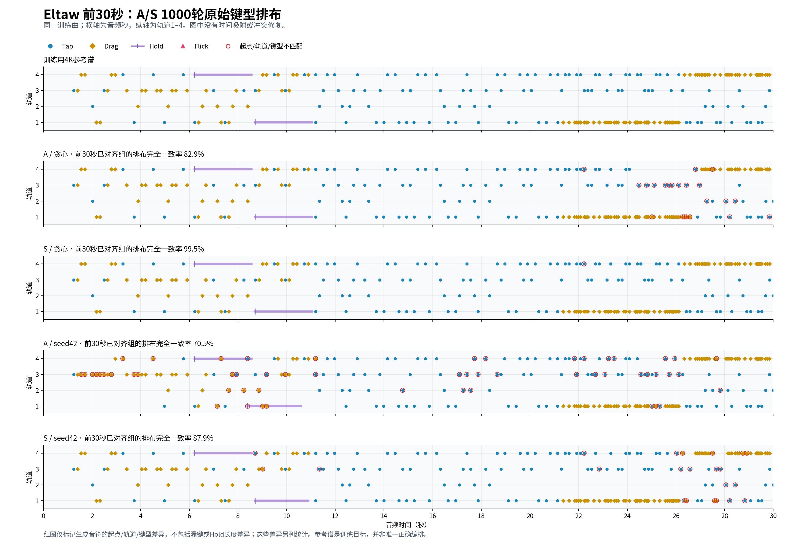

# A/S 1000轮键型排布复核

2026-10-25（Sydney）。对象为 `AL-AR4K v0.5.1 / E14-A、E14-S / e1000`：A不使用额外起音通道，S保留软起音。只复算已经保存的原始生成结果；没有训练、重新采样、吸附时间或修复冲突。另检查A/e0920、S/e0960等已保留断点，避免把最后一轮当作最佳权重。

结论：S贪心已几乎复现Eltaw的完整轨道/键型序列，A的时间定位明显好于排布；两者均不再全Tap。S在另外两首训练曲、跨轮和采样下仍有明显差异，尚不能把单曲复现提升为稳定编谱能力。

## 对照对象与口径

参考来自已核验SHA的全量300首缓存中的4K训练标签，沿用原BPM、offset、token→秒转换。它是派生4K参考谱，不是声学真值，也不是音乐编排的唯一正确答案。三首都是已见训练曲；本次指标用于检查拟合和上下文排列能力，不规定Hold比例或模式配额。

- 起点沿用现有50ms容差的一对一最优匹配，先最大化命中数，再最小化时间误差。
- **联合音符F1**：在上述对应起点内还要求轨道和键型相同；分母包含全部参考与预测音符，未匹配的起点也会影响分数。Hold长度另计。
- **整组排布一致率**：在已匹配起点中，整组轨道×键型集合完全一致的比例；包含同时键，不包括Hold长度。该分母有条件性，不能单独忽略漏掉的起点。
- **连续四组复现率**：参考中相邻四组的轨道×键型全部一致，且对应预测组也连续；分母为全部参考四组窗口。它检查局部序列一致性，不是对任意新谱面的音乐性判分。
- Hold持续长度误差只在起点、轨道、键型均匹配的Hold中计算；同时报告匹配数量，避免只挑容易的Hold。

全部参考谱与自身对照均得到联合F1和连续四组复现率1.0、Hold长度误差0；36份复算的起点F1与原评测逐项一致。完整数值、定义及输入指纹见[JSON](assets/ar_layout_1000_20261025/summary.json)。分析脚本位于本地 `out/ar_layout_1000_20261025/analyze.py`，SHA记录于JSON；原benchmark实现未改变。

## Eltaw：起点高分不能代表排布正确

| 1000轮输出 | 起点F1 | 联合音符F1 | 已对齐整组排布一致 | 连续四组复现 |
| --- | --- | --- | --- | --- |
| A 贪心 | 0.9914 | 0.8017 | 74.93% | 59.17% |
| S 贪心 | 1.0000 | 0.9965 | 99.57% | 98.28% |
| A seed42 | 0.9355 | 0.5987 | 54.26% | 24.64% |
| S seed42 | 0.9871 | 0.7535 | 69.90% | 46.28% |

四份输出均自然结束。A和S贪心都生成847个音符，数量与参考相同，但A只有679个、S有844个音符同时满足时间、轨道、键型匹配。总数或类型比例接近不能替代逐键核对。

| 键型 | 参考数量 | A贪心数量 / 联合F1 | S贪心数量 / 联合F1 |
| --- | --- | --- | --- |
| Tap | 604 | 609 / 0.8046 | 604 / 0.9967 |
| Drag | 156 | 140 / 0.9054 | 156 / 0.9936 |
| Hold | 41 | 48 / 0.5169 | 41 / 1.0000 |
| Flick | 46 | 50 / 0.7083 | 46 / 1.0000 |

S贪心剩下的3处错误都是轨道差异：22.228秒的3轨Tap放到4轨，31.399秒的4轨Tap放到3轨，70.415秒的4轨Drag放到3轨。698/701组完全一致；41个Hold全部匹配，持续长度在1微秒数值容差内与参考一致。起点本身仍有毫秒级偏差，不能把长度一致解释为全部时间精确相等。

A贪心41个参考Hold仅匹配23个，其中19个持续长度一致；这23个的长度平均绝对误差27.03ms。同轨Hold持续期间出现其他音符起点的事件对：参考0、A贪心7、S贪心0；A/S采样分别31/6。Hold与Hold重叠对分别为0/0/9/2（A贪心/S贪心/A采样/S采样）。这些是几何关系，需结合Phira触屏操作复核，不自动等同非法或不可玩，也没有施加双指限制。

## 前奏重复、交互和楼梯

[高清PDF](assets/ar_layout_1000_20261025/eltaw_intro.pdf)。前30秒已对齐整组排布一致率为A贪心82.89%、S贪心99.47%；连续四组复现率为73.26%/97.86%。S几乎完整复现前奏参考排列，A在22秒之后逐渐出现错轨、漏掉/新增同时键。采样的前30秒整组一致率为A70.53%、S87.89%，分别低于同权重贪心。

以下是整个Eltaw参考中的四个单键起点几何窗口，在对应时间完整复现轨道和键型的数量；同时键会中断单键窗口，不跨过同时键拼出模式：

| 参考模式（全部键型） | 参考窗口数 | A贪心完整复现 | S贪心完整复现 |
| --- | --- | --- | --- |
| 同轨AAAA | 9 | 7 | 9 |
| 交互ABAB | 51 | 30 | 51 |
| 严格单向四轨楼梯 | 8 | 6 | 8 |

这说明模型已经能复现有前后依赖的排列，不能继续把它描述成只会逐键生成Tap。但“参考中的模式被复现”不等于已经验证模型对新音乐的重复/模进能自主做出合适编排；本次没有新增音频段落或旋律标注。

旧benchmark里的“同轨串”只看几何，不限制键型和间隔。例如Eltaw的最长5键同轨串是跨约8.7秒的Flick，不能当作高速长纵；ABYSS的参考60键同轨串混有Hold/Flick/Drag，也不是60连Tap。

本次另给出明确的Tap子集诊断：只含连续单Tap，同时键/其他键型中断，间隔不超过半拍加10ms；这不是通用玩法定义或新验收门槛。Eltaw参考有25条2–3键同轨Tap串、33个四键交互窗口、6个四键楼梯窗口；A分别22/31/5，S分别25/33/6。参考没有4键及以上的这种Tap同轨串，不能用Eltaw证明长纵能力。ABYSS参考只有2条4键Tap同轨串，A未生成、S生成2条；样本数量仍不足以验证更多长度与速度。

## 换曲和换轮次仍会变化

| 1000轮贪心 / 联合音符F1 | A | S |
| --- | --- | --- |
| Eltaw | 0.8017 | 0.9965 |
| SURREALISM | 失败；局部诊断0.3609 | 0.4664 |
| ABYSS MOTION | 0.4604 | 0.8534 |

S在这三首的当前贪心排布更好，但SURREALISM仍明显较差，且自然结束不保证尾段覆盖。不能把这三首训练曲的结论外推到全300首或独立歌曲。

已有候选也不能只按起点F1选：A/e0920贪心在Eltaw的联合F1=0.9268，高于A/e1000的0.8017；S/e0960贪心在SURREALISM的联合F1=0.8509，高于S/e1000的0.4664。所有候选保持留存。当前没有一轮同时解决全部曲目的排布、结束与稀疏音频探针。

相同权重从贪心换为固定seed42采样，Eltaw的联合F1与连续序列复现明显下降，说明解码轨迹也影响排布；这不等于已经完成采样策略优化或证明某个训练原因。按用户约定，本次不调整采样、不改历史输入，也不启动新训练。

后续判断模型时应同时看起点、联合音符匹配、连续模式和Hold关系。已有高分输出证明当前结构可以学习复杂训练谱排布；当前缺口是这种能力跨曲、跨轮和自由生成时的稳定性，而不能仅以“起点F1接近1”判定可玩。
