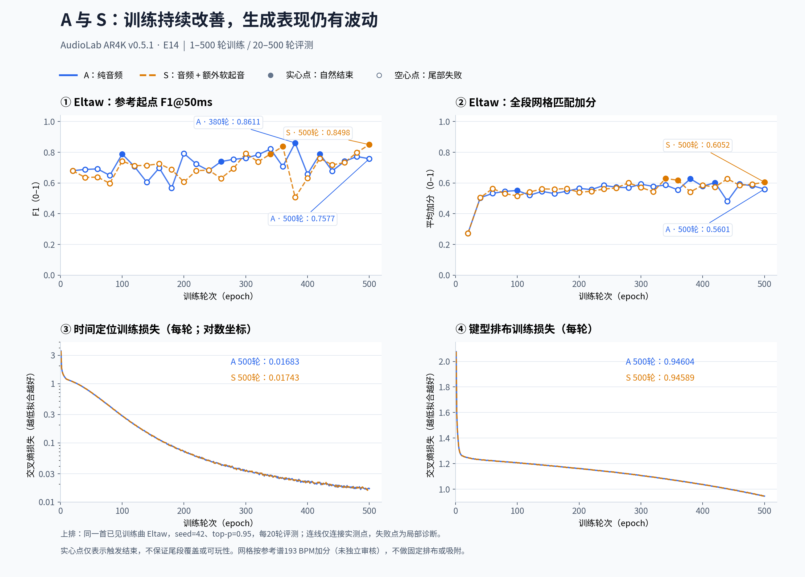

# AR 续训：先检验既有结构的训练充分程度

2026-10-23。用户要求保留[定长归因/编谱计划](../fixed_length_attribution_plan.md)，先继续训练未充分训练的模型，允许过拟合，不能再次用短跑结果替代架构能力判断。新定长课程和 diffusion 结构实验暂不执行。

## 运行状态

当前状态为 **running**：两组已完成500轮、150,000步，用户于2026-10-24授权继续原配方到700轮，质量尚未通过。训练脚本 commit `37a3650`。原 epoch-10 的 `out/anchored_ar_20261023/{audio,soft}/model_latest.pt` 只读保留；10→300轮结果在原根目录，300→500轮在 `continued500/{audio,soft}`，当前500→700轮在 `continued700/{audio,soft}`。下文保留各阶段观察；图表当前截至500轮，新的进展另行追加。



[高清PDF](assets/ar_saturation_20261023/comparison.pdf) · [评测数据CSV](assets/ar_saturation_20261023/evaluation.csv) · [逐轮训练CSV](assets/ar_saturation_20261023/training.csv) · [数据来源与SHA](assets/ar_saturation_20261023/provenance.json)

上排为Eltaw、seed42/top-p=.95的第20–500轮评测，每20轮一个实测点；下排为两组第1–500轮训练损失。实心点仅表示自然结束，空心点为尾部失败的局部诊断，连线不代表中间轮次也做了评测。50条评测共用同一音频、参考起点和时基，网格由保存的原始预测按原benchmark计算；训练共1,000条逐轮记录，未平滑或补造缺失指标。两组拟合曲线接近，生成分数仍明显波动，不能从最后一轮或单曲峰值认定某一路线稳定胜出。480轮评测记录可用于作图，但该轮权重未留存。

两组各从累计 epoch 10 / step 3000 继续：

- `audio`：连续声学特征，显式软起音置零。
- `soft`：相同声学特征，保留全部软起音概率/偏移。

保持 6,626,691 参数、全量 300 首、两份真实平移短段/等长静音、原损失、dropout、全局 cross-attention、解码/采样不变。恢复 AdamW 动量、Python 样本采样 RNG、torch CPU/CUDA RNG。续训保留实际末步学习率 `3e-5`，不重置 warmup；原 `3e-4` 仍记为 pilot 基础 LR，实际续训 LR 单列。编码器仍冻结，结论范围是当前前端/数据/损失条件下解码器的拟合能力，不是理论上限。

完整目标暂记累计 300 轮，首个观察段到 100 轮；到达观察点后根据曲线决定继续，不以轮数本身宣告收敛。每 20 轮运行同一三首训练曲、四个正例钢琴探针、真实静音与平移诊断，分别记录 greedy 和 seed42/top-p=.95。评测在 RNG fork 内执行，不消费训练 dropout 的随机状态。固定 benchmark 不入训。

## 可恢复性与资源

每轮原子覆盖 `model_latest.pt`（含 AdamW/RNG），仅保留一个额外 `model_best_fit.pt`（无优化器，只作推理）；评测保存小型结果到 `evaluation-eNNNN/`。最佳拟合依据汇总训练目标，不能等同于最佳编谱。原基线不覆盖，缓存不复制，不新增长期分支/worktree。

限制：剩余磁盘至少 8 GiB、可用 RAM 至少 8 GiB、单进程 RSS 上限 4 GiB、单 GPU 分配比例 0.65。两张 3090 分别运行两组。启动前剩余磁盘约 16.6 GiB、RAM 约 37 GiB。

续训入口检查 schema、变体、网络参数、数据缓存哈希、损失/解码策略、完整 epoch、优化器/RNG。与 pilot 训练提交 `099ee90` 的 AST 比较确认 `encode_target`、`time_intervals`、`AnchoredAR`、`normalized_loss` 相同；先前仅推理边界/失败诊断发生修正。27 项测试通过，包括 AdamW/RNG 恢复后下一次更新逐张量一致、评测 RNG 隔离以及原模型测试。

## 判读规则

- 训练集对应得分在本轮作为可拟合性诊断，不能升级为复杂编谱的唯一目标。自然曲参考谱仍是多个有效编排之一。
- 同时看训练定位/排布/停止损失、完整自由生成、末段覆盖、四键型/模式和探针错漏。真实历史指标不冒充自由生成指标。
- 整曲尾部继续生成仍按失败记账；失败前事件只作局部诊断，不能把这种输出的 F1 当完整通过。
- 持续下降意味着仍可训练；平台需记录观察窗口与优化条件。预算到期不能标“已收敛”。不以独立歌曲泛化损失早停，不因过拟合主动停止。
- 不宣称任何有限训练实验穷尽架构理论上限；如果训练目标拟合而自由生成仍差，需区分训练/推理差异与结构能力。

## 命令

两组分别指定 `--gpu 0/1`、`--variant audio/soft`：

```bash
.venv/bin/python -u -m script.train_models --gpu 0 \
  --worker script.train_anchored_ar -- train --variant audio \
  --continue-from out/anchored_ar_20261023/audio/model_latest.pt \
  --output out/ar_saturation_20261023/audio \
  --epochs 300 --until-epoch 100 --eval-every 20
```

恢复同一运行加 `--resume`，保持其余配置；延长观察段只改 `--until-epoch`，不会重置恒定学习率。最终结论与曲线在运行获得实测后补充。

## 第 20 轮观察（仍在续训，未收敛）

| 指标 | epoch 10 audio / soft | epoch 20 audio / soft |
| --- | --- | --- |
| 训练定位 CE | 1.18973 / 1.18978 | 1.07968 / 1.07987 |
| 训练帧准确率 | 62.041% / 62.052% | 65.327% / 65.311% |
| 训练末尾停止召回 | 30.75% / 30.75% | 35.167% / 35.0% |
| 三首整曲自然停止，greedy 和 seed42 分别 | 两组均 0/3、0/3 | 两组均 0/3、0/3 |

两组训练曲线继续改善，还不能认为训练充分。整曲错误仍是 `continued with no future audio interval`，所有完整生成仍失败。Eltaw seed42 的失败前局部起点 F1 为 audio 0.68005、soft 0.67957；这仅是训练集部分输出的定位诊断，不能作为完整成谱质量提升。

普通三音 seed42 两组都只生成约 4.006 秒处的一个双 Tap（一个唯一起点），F1=0.5，只匹配 1/3 真值且漏掉另外两次；不能将它称为通过。greedy 仍产生 35 个起点且尾部停止失败。弱音 seed42 F1=0.14815，跨块 seed42 F1=0.04878；纯静音为空谱。

greedy 的三首自然曲仍全 Tap；Eltaw seed42 的 audio 为 Tap 782 / Drag 91，soft 为 Tap 774 / Drag 91。没有按类型数量选模。平移诊断中 SURREALISM 首音约 1.103 / 1.935 秒（真值 1.198 / 1.948 秒），Eltaw 的两次首音仍约 3.042 / 2.571 秒，顺序问题仍在。

原始结果：`out/ar_saturation_20261023/{audio,soft}/evaluation-e0020/{inputs,report,diagnostics}.json`。评测后单进程 RSS 约 2.1 GiB，torch 显存峰分配 0.306 GiB / 预留 0.531 GiB，剩余磁盘约 16.36 GiB。训练自动进入后续 epoch，未停止或切换默认产品权重。

用户追问节奏表现，另对失败前原始输出调用同一 `rhythm_bonus`，不修改失败状态、不吸附或调时基。Eltaw/audio/seed42：全段平均网格奖励 epoch10 0.24718 → epoch20 0.27185；前 30 秒 0.24997 → 0.23107；首个出键 1.233s → 4.659s。前 30 秒唯一起点 196 → 150，ABAB 四起点窗口 35 → 30（数量不是模式质量）。全段略升不能掩盖前奏覆盖/节奏指标退步，尚未验证交互串与音乐重复/模进的对应。时基固定为参考谱 193 BPM / 零点 0s，未经独立拍点审核。结果及输入指纹在 `out/ar_saturation_20261023/rhythm_e0020.json`。

## 第 40 轮观察（训练继续，未收敛）

两组训练定位 CE 为 audio 0.83260 / soft 0.83297，帧准确率为 72.894% / 72.922%，末尾停止召回均为 45.5%。排布 CE 仍约 1.23124；时间定位的学习进度不能替代键型编排能力。两组曲线接近，不能据此认定软起音条件已有收益。

Eltaw 使用同一参考时基与奖励规则，原始输出不吸附网格：

| audio 指标 | epoch 20 | epoch 40 |
| --- | --- | --- |
| seed42 全段奖励/起点 | 0.27185 | 0.50394 |
| seed42 前 30 秒奖励/起点 | 0.23107 | 0.45810 |
| seed42 全段最长连续匹配起点数 | 19 | 64 |
| seed42 首键时间 | 4.659s | 4.662s |
| greedy 全段奖励/起点 | 0.28206 | 0.48732 |
| greedy 前 30 秒奖励/起点 | 0.26011 | 0.52993 |

soft 的 epoch40 seed42 全段/前 30 秒奖励为 0.50426 / 0.50058，但前 30 秒只生成 99 个唯一起点，audio 为 152 个，不能只凭平均奖励选优。两组 greedy 都约 1.235s 起键，且 Eltaw 几乎整首为机械 ABAB，全为 Tap；尚未证明键型能对应音乐的重复和模进。seed42 的 audio 为 Tap 869 / Drag 10，soft 为 Tap 748。

Eltaw 两种解码、两组变体仍在尾部失败，以上只评价失败前局部输出，不能作为完整成谱通过。三首自然曲仅 audio/seed42 的 ABYSS 出现一次自然停止（最后起点 117.648s）；其他 11/12 条整曲运行仍失败，自然停止本身也不保证首尾覆盖。普通三音 greedy 的 audio 生成 7 个起点、只命中 2/3；seed42 生成 17 个起点，F1=0.2，仍未通过三音契约。静音保持空谱。

平移短段中的 Eltaw 首键改善到约 1.327s / 2.574s，真值为 1.331s / 2.652s。训练时间定位和部分自由节奏已有实测改善，复杂编排、开头漏段与停止仍需继续观察，不据此结束续训。

结果：`out/ar_saturation_20261023/{audio,soft}/evaluation-e0040/`；节奏及模式明细：`out/ar_saturation_20261023/rhythm_e0040.json`。各额外保留一份无优化器的 `model_e0040.pt`（约 25.3 MiB），便于复查阶段性现象；剩余磁盘约 16.30 GiB，可用 RAM 约 35 GiB，单进程 RSS 约 2.17 GiB。两个 worker 已自动继续后续 epoch。

## 第 60–100 轮：贴拍改善，完整生成仍不稳定

继续使用同一时基、同一 seed42/top-p=.95，以下为 Eltaw/audio。epoch10–80 是失败前局部诊断，epoch100 是自然停止的完整输出；各阶段不修正时间，不吸附网格。

| epoch | 全段奖励/起点 | 前 30 秒奖励/起点 | 首键（秒） | 唯一起点 | 生成状态 |
| --- | --- | --- | --- | --- | --- |
| 10 | 0.24718 | 0.24997 | 1.233 | 1098 | 尾部失败 |
| 20 | 0.27185 | 0.23107 | 4.659 | 793 | 尾部失败 |
| 40 | 0.50394 | 0.45810 | 4.662 | 685 | 尾部失败 |
| 60 | 0.53221 | 0.49044 | 4.661 | 606 | 尾部失败 |
| 80 | 0.54580 | 0.51291 | 4.661 | 589 | 尾部失败 |
| 100 | 0.55080 | 0.54700 | 1.237 | 720 | 自然停止 |

第100轮 audio/seed42 的 Eltaw 首键 1.23744s（参考首键 1.24352s），末键和停止点 130.37931s（参考末键 130.56995s），起点 F1@50ms=0.78818。这是可拟合性诊断；复杂编谱仍有多种有效答案，F1 不等于编谱质量。全谱 Tap 751 / Drag 4 / Hold 2；没有按类型配额选模。各 30 秒区间的生成唯一起点为 179/188/106/183/64，参考谱为 190/139/135/208/29，段落密度仍有差异，尤其尾段偏密，不能只看全谱平均分。

第100轮两组训练指标：

| 指标 | audio | soft |
| --- | --- | --- |
| 时间定位 CE | 0.28531 | 0.28548 |
| 训练帧准确率 | 90.200% | 90.236% |
| 排布 CE | 1.20634 | 1.20627 |
| 训练末尾停止召回 | 69.250% | 69.583% |

第80轮定位 CE 约0.414，至第100轮仍明显下降，因此继续训练，不宣布收敛。排布损失改善较慢；greedy 的 Eltaw 仍全 Tap、整首 ABAB。soft/seed42 的 Eltaw 首键同样回到1.237s，但尾部仍失败，全段/前奏奖励为0.51578/0.55216。第100轮十二条自然曲生成中，仅 audio/seed42/Eltaw 一条自然完成；其他曲目仍有漏掉开头、尾部继续生成的问题。

普通三音 audio/seed42 生成5个起点，只命中2/3，F1=0.5；其他正例探针也未全部通过。静音仍为空谱。故本阶段结论为：延长训练确有节奏定位收益，不能据此宣称整体编谱可用或架构能力已经测完。

会话服务重启时两个训练 worker 仍在运行，没有重复启动。确认两组100轮评测写完且旧进程退出后，使用原命令加 `--resume`，仅将 `--until-epoch` 改为300；实际学习率仍为3e-5，优化器、随机状态、300首训练数据及损失保持不变。已确认两组完成第101轮并进入第102轮。后续日志为 `audio_resume100.log` / `soft_resume100.log`。另各保留约25.3 MiB的 `model_e0100.pt`；恢复时剩余磁盘约15.83 GiB，可用 RAM 超过35 GiB。

汇总数据及曲线在 `out/ar_saturation_20261023/observation_e0100.{json,png}`，逐轮原始结果在各变体的 `evaluation-eNNNN/`，节奏明细及输入指纹在 `rhythm_e0060.json`、`rhythm_e0080.json`、`rhythm_e0100.json`。恢复过程中的 `elapsed_seconds` 首次累加会重复计入 epoch10 父运行的历史时长；这是计时元数据问题，后续耗时应从恢复后的相邻 epoch 差值估算，不据跨恢复点差值计算速度。运行中暂不修改训练源码。

## 解码与训练的区别，以及后续对照

当前训练使用真实 tokens、真实时间和真实历史做 teacher forcing，离散输出使用交叉熵/停止 BCE，子帧偏移使用回归损失。greedy/seed42 都在无梯度评测中运行，且评测隔离训练 RNG，不把生成轨迹反传进训练。

推理共用 `select`：先应用 top-p=.95，再执行 argmax（greedy）或按概率抽样（seed42），温度相当于1。停止/继续、时间帧、排布 token 都调用此函数；帧内偏移是连续回归。两种解码共用权重，不能称为两种训练模型。

可在充分训练后冻结同一权重做推理消融：温度加 top-p/min-p、按停止/时间/排布分开设置采样参数、beam search、多候选后依据音频对应和段落完整性重排。它们分别调整随机性、控制不同决策的风险、探索多条路径或筛选候选；没有一种保证比其他策略更适合编谱。网格仍只加分，不把键型多样化本身作为正确性，也不套用文本去重惩罚破坏音乐中的合理重复。[Transformers 解码说明](https://github.com/huggingface/transformers/blob/main/docs/source/en/generation_strategies.md)、[采样参数实现](https://github.com/huggingface/transformers/blob/main/src/transformers/generation/configuration_utils.py)。

若研究训练时真实历史与推理时生成历史之间的差异，可另做混入模型生成历史的训练对照；这才改变训练。对本项目还需处理生成时间改变后监督目标的有效性，不能直接随机替换 token 后照搬旧标签。本轮继续保持原训练设置，未实施这些改动。[Scheduled Sampling 原论文](https://arxiv.org/abs/1506.03099)、[Transformer 对应研究](https://arxiv.org/abs/1906.07651)。

## 第120轮监测（用户要求采样优化留待后续）

保持训练和推理配置。训练定位 CE 为 audio 0.20376 / soft 0.20410，帧准确率为93.061% / 93.075%，排布 CE 约1.1980，汇总末尾停止召回约75.4%。这些汇总训练指标包含整曲、平移短段和静音，不能替代整曲自由生成的停止率。

Eltaw/audio/seed42 首键仍为1.238s，但尾部再次失败；全段/前30秒奖励为0.52040/0.55190，唯一起点708，起点F1@50ms=0.70688（失败前局部诊断）。soft 对应奖励为0.54124/0.53358，同样失败。贪心版两组仍全 Tap、ABAB。第100轮 audio/Eltaw 的自然停止未在第120轮重现，不能按一次成功宣称已稳定解决。

十二条自然曲生成中，仅 audio/seed42/SURREALISM 自然停止（首键约8.000s、末键151.366s），其余11条尾部失败。普通三音两组两种解码均仅生成约1.005s和9.996s两个起点，只命中1/3，F1=0.4；静音仍为空谱。定位训练继续改善，自由生成与排布问题仍未解决，不因为阶段性退步或过拟合而提前停止。

原始结果在 `evaluation-e0120/`，节奏/模式明细及指纹在 `rhythm_e0120.json`。本轮评测后磁盘余约15.83 GiB，可用 RAM 约35.1 GiB。worker 自动继续后续训练。

真实历史诊断进一步区分了问题：第120轮 audio 的 SURREALISM/ABYSS/Eltaw 帧准确率为95.65%/95.42%/99.29%，但对应真实末尾的停止概率仅为2.52%/0.07%/61.93%。前两曲连真实历史下的停止也未学好；Eltaw 则定位拟合已很高，自由轨迹仍失败。不能把汇总75%的停止召回解释为整曲都已学会停止，也不能只用“定位还没充分拟合”解释全部失败。

## 与三月 diffusion 的第120轮对照

读取已经精确复现用户 Eltaw v2 的三月预测，与第100/120轮 AR 保存输出重算同一指标。逐例验证音频SHA、参考起点、时长和节拍时基一致；未重新生成、调参数或修改失败状态。三月旧时轴和固定长度行为保持历史实现，因此不是等容量/等预算的架构对照。

| Eltaw / seed42 | 三月 diffusion v2 | AR audio 第120轮 |
| --- | --- | --- |
| 参考起点 F1@50ms | 0.71993 | 0.70688，失败前局部诊断 |
| 起点匹配 precision / recall | 90.50% / 59.77% | 70.34% / 71.04% |
| 未匹配参考起点的输出数 | 44 | 210 |
| 全段网格奖励/起点 | 0.25055 | 0.52040 |
| 四类型 Tap/Drag/Hold/Flick | 252/242/35/2 | 770/0/0/0 |
| 推理状态 | 完成 | 尾部失败 |

其他两曲 SURREALISM/ABYSS 的三月 F1 为0.8000/0.78183，第120轮 audio 为0.60946/0.66573（后者尾部失败，只作部分诊断）。三月三条自然曲均完成推理；本轮 audio 仅1/3，soft 为0/3。三月钢琴三音探针全漏，AR 仍漏音/额外出音，双方都未通过该契约。

AR 第100轮 Eltaw 曾自然完成且 F1=0.78818，因此已出现局部超过的结果，但未稳定重现；不能凭峰值或更高网格奖励宣称整体优于三月版本。键型数量本身不是正确性标准，当前也没有新的盲听/试玩证明 AR 编排已超过三月。比较明细、输入/协议指纹保存在 `out/ar_saturation_20261023/diffusion_comparison_e0120.json`；失败结果没有混入“完整通过”的评分。

## 第140轮监测

训练定位 CE 约0.149、帧准确率约95%，排布 CE 约1.189，继续下降。三首诊断曲在真实历史条件下的 audio 帧准确率为98.78%/99.24%/99.57%，末尾停止概率为29.07%/0.06%/89.13%；soft 结果相近。ABYSS 的真实末尾停止仍明显没学会，Eltaw 则真实历史下已能给出较高停止概率，自由生成仍失败。

Eltaw/audio/seed42 全段/前奏奖励0.54508/0.53850，480个起点、575个Tap，局部F1=0.60457；soft 为0.56141/0.54284、617个起点、625个Tap，局部F1=0.71472。两组首键约1.239s，均在尾部失败。audio 三曲两种解码均失败；soft/seed42 的 SURREALISM、ABYSS 能自然停止，但首/末起点分别约7.998s/144.351s、3.741s/121.834s，不能仅按完成状态认定段落覆盖合格。普通三音采样仍只命中1/3，跨块探针仍额外出音。原始数据在 `evaluation-e0140/`，明细在 `rhythm_e0140.json`。

当前证据表明真实历史下的定位拟合接近饱和，尚不能说明排布、停止和自由轨迹已充分训练。按用户要求继续原设置，不开展采样调整。磁盘余约15.82 GiB，可用 RAM 约35.1 GiB。

## 第160轮监测

audio/soft 训练帧CE为0.11387/0.11365，帧准确率均约96.24%，排布CE均约1.1808。两组定位拟合继续改善，但三首自然曲、两种解码的12条结果全部在尾部失败。

Eltaw/seed42 的 audio/soft 局部起点F1为0.69810/0.72484，全段网格奖励0.53103/0.55988，前30秒奖励0.54423/0.57119；两组均约1.239s起始，分别输出809/859个Tap。这里仍是失败整谱的局部诊断，不能作为完整成谱通过。普通三音采样命中2/3但多出音符，F1约0.444；跨块探针仍失败，静音保持无音符。明细见 `rhythm_e0160.json` 和各组 `evaluation-e0160/`。

用户要求A/S两套权重保持独立；目前额外soft起音没有稳定优势，本轮按原设置继续到300轮，之后再决定是否停用S路线。模型统一身份为 `AL-AR4K v0.5.1 / A或S / E14`，命名与资产入口见[模型总表](../model_catalog.md)。

## 第180轮监测（AL-AR4K v0.5.1 / E14）

两组均完成54000步，保持独立权重、优化器和原定300轮预算，未调整采样或模型结构。

| 第180轮同条件比较 | A：纯音频 | S：额外soft起音 |
| --- | ---: | ---: |
| 训练帧CE / 帧准确率 | 0.09071 / 97.02% | 0.09044 / 97.06% |
| 训练排布CE | 1.17012 | 1.17016 |
| Eltaw/seed42 起点F1@50ms（失败谱局部诊断） | 0.56642 | 0.68774 |
| Eltaw 全段 / 前30秒网格奖励 | 0.54668 / 0.56148 | 0.56359 / 0.57900 |
| Eltaw 起点数 / 音符数 | 383 / 429 | 596 / 832 |
| 三首自然曲、两种解码自然完成数 | 0/6 | 0/6 |

两组Eltaw首键为1.24077s/1.24127s，均全Tap，尾部报 `continued with no future audio interval`。贪心版仍全Tap且四起点位置模式均为ABAB。S的本轮Eltaw分数优于A，但其他曲目有升有降，且两组均未修复终止失败，不能由这一条结果断言额外起音有稳定收益。第160轮的对应采样F1为0.69810/0.72484，本轮两组均下降。

真实历史条件下，A在SURREALISM/ABYSS/Eltaw的时间帧准确率为99.73%/99.85%/100%，末尾停止概率为94.49%/1.14%/94.71%；S分别为99.86%/99.69%/99.86%及93.47%/1.49%/90.99%。这清楚区分了训练曲的真实历史拟合与自由生成：Eltaw真实历史下定位/停止已能拟合，但生成自己的历史后仍失败；ABYSS的真实末尾停止本身仍未学好。尚不能仅凭这些诊断确定唯一原因或宣称架构达到能力上限。

普通三音采样仍为命中2/3、生成6个起点（F1=0.44444）；跨窗口探针仍失败，静音保持0音符。原始预测/权重哈希与诊断见各组 `evaluation-e0180/`，同协议网格及模式统计见 `out/ar_saturation_20261023/rhythm_e0180.json`。观察时A/S已恢复到182/181轮，磁盘余约15.81 GiB、可用RAM约35.1 GiB，无训练报错。

## 185/183轮中断与恢复

2026-10-23 09:50 UTC检查时，两组训练进程均已不存在。A最新断点为185轮/55500步，S为183轮/54900步；旧日志最后更新时间约09:24 UTC，没有Python异常或正常训练完成标记，退出原因尚不明确。此前仅根据训练文件读出的185/183轮不能证明进程仍在运行，后续监测同时检查进程与日志推进。

两份断点可完整加载，包含模型、AdamW、采样器、Torch/CUDA随机状态，训练源文件SHA全部一致。09:54 UTC从各自断点恢复，原目标300轮、每20轮评测、3e-5学习率以及结构/损失/采样均未改动；300首数据校验通过，并观察到A第186轮、S第184轮的步数增长。旧日志保留，新日志为 `audio_resume185.log`、`soft_resume183.log`；恢复前断点哈希及启动记录见 `out/ar_saturation_20261023/resume_audit_185_183.json`。中断轮内未保存的更新从上一个完整断点重新执行。

用户提出“独立谱面不结束可能过度依赖上下文，需要加强谱面的权重”，作为待验证假设保留；具体权重与训练方案尚未确定。用户明确要求先继续本轮训练，后续再决定改动，本次恢复不引入新配方，也不将这一假设写成已证实原因。

## 第200轮监测（AL-AR4K v0.5.1 / E14）

两组均完成60000步。A/S训练帧CE为0.07187/0.07170，帧准确率97.73%/97.69%，排布CE均约1.1623。结构、损失、学习率、采样均保持原设置。

| Eltaw/seed42，同协议失败谱局部诊断 | A：纯音频 | S：额外soft起音 |
| --- | ---: | ---: |
| 起点F1@50ms | 0.79211 | 0.60654 |
| 全段 / 前30秒网格加分 | 0.56495 / 0.54662 | 0.53945 / 0.57166 |
| 起点数 / 音符数 | 718 / 943 | 430 / 725 |
| 首键时间 | 1.24033s | 1.24103s |

Eltaw两组均全Tap，尾部继续失败；贪心版仍为全Tap与ABAB。A的Eltaw起点匹配明显回升，但这是失败谱的局部诊断，不能当作比第100轮完整生成更好的成谱结果。SURREALISM采样F1为A=0.64793、S=0.71855，ABYSS为A=0.65076、S=0.54725；三曲两种解码共12次仍全部尾部失败，尚无稳定的soft收益。

真实历史条件下，A三首曲的时间帧命中率均100%，末尾停止概率为95.51%/4.73%/86.50%；S帧命中率为100%/99.85%/100%，停止概率为81.86%/4.75%/71.75%。ABYSS真实末尾停止仍未学好；其他曲目则存在明显的真实历史拟合与自主生成差距。普通三音探针两组均生成约1s和10s的两个起点，仅命中1/3，F1=0.4；弱音/重复音与跨窗口探针仍未通过，纯静音保持0音符。

网格奖励仅描述指定tick相位的贴合，不等于起点命中率或听感质量。Eltaw的参考时钟193 BPM下1 tick约9.7ms，当前奖励在偏离1 tick时衰减至0；F1@50ms则允许与参考谱起点相差50ms，二者不可按同一尺度解读。用户认为三月diffusion试玩合拍，与其较低网格奖励并不矛盾。原始结果、诊断与权重哈希见两组 `evaluation-e0200/`；网格/模式明细见 `out/ar_saturation_20261023/rhythm_e0200.json`。继续监测到300轮，不提前更改训练方案。


## 第220轮监测（AL-AR4K v0.5.1 / E14）

A/S训练帧CE为0.05955/0.05917，帧准确率98.10%/98.12%，排布CE约1.1523。Eltaw/seed42局部起点F1为0.72328/0.68016，全段网格加分0.55697/0.54616，前30秒0.57633/0.56402；两组均尾部失败。A生成665个起点、840个Tap；S为534个起点、766个Tap和3个Flick。贪心版Eltaw仍全Tap与ABAB。

三首自然曲、两种解码中，A仅SURREALISM/seed42触发EOS（1/6），S为0/6。该条生成首/末起点1.33479s/144.35618s，参考为1.33333s/148.0s，末起点比参考早3.64382s；不能将自然停止直接写成尾段覆盖通过。SURREALISM采样F1为A=0.68458、S=0.63174，ABYSS为A=0.69331、S=0.60313（均失败）。

真实历史下A三曲的帧命中率为100%/99.85%/99.86%，末尾停止概率99.40%/21.74%/96.93%；S为100%/99.69%/100%及98.57%/28.73%/97.90%。ABYSS停止拟合在改善，但仍未达到0.5；Eltaw真实历史末尾停止接近97%，自由生成仍失败，继续保持原训练方案观察。

三音采样两组均仅命中1/3、生成3个起点，F1=0.33333；贪心三音出现尾部失败和额外出音。跨窗口仍失败，纯静音均0音符。两组第220轮轻量推理快照已保存为各自 `model_e0220.pt`，每份约25.4 MiB；源断点哈希与对应评测记录一致，快照哈希见 `checkpoint_snapshots.json` 和模型台账。此快照不含优化器，续训仍使用 `model_latest.pt`。完整指标见各组 `evaluation-e0220/` 与 `rhythm_e0220.json`。


## 第240轮监测（AL-AR4K v0.5.1 / E14）

A/S训练帧CE为0.05064/0.05025，帧准确率98.39%/98.41%，排布CE约1.1411。Eltaw/seed42起点F1为0.68114/0.68379，全段网格加分0.58447/0.56024，前30秒0.56676/0.56223；均为尾部失败谱的局部诊断。A有497个起点、536个音符（Tap488/Hold34/Flick14），S有545个起点、772个音符（Tap771/Hold1）。A出现部分Hold/Flick，不代表这些键型已与音频匹配；S贪心版出现较长AAAA重复，不能把统计中的模式变化直接当作编排能力通过。

三首曲两种解码的12次自然曲生成全部尾部失败。SURREALISM采样F1为A=0.65882、S=0.67393，ABYSS为A=0.63816、S=0.66955。真实历史下两组三曲帧命中率均100%；A末尾停止概率为97.74%/42.52%/95.34%，S为97.51%/62.82%/98.35%。S在这三首真实历史的末尾都越过0.5停止阈值，自主生成仍失败，训练与自由轨迹之间的差距继续存在。

普通三音采样两组均仅匹配1/3，生成6/5个起点，F1=0.22222/0.25；贪心两组命中3/3但均生成20个起点并尾部失败，不能只报召回而忽略额外出音。跨窗口仍失败，纯静音均0音符。两份 `model_e0240.pt` 快照已保留，源断点哈希与第240轮评测一致；完整证据见 `evaluation-e0240/`、`rhythm_e0240.json`、`checkpoint_snapshots.json`。原训练方案继续到300轮。


## 第260轮监测（AL-AR4K v0.5.1 / E14）

A/S训练帧CE为0.04334/0.04267，帧准确率98.62%/98.66%，排布CE约1.1317。Eltaw/seed42的A本轮触发EOS，起点F1=0.73916、全段/前30秒网格加分0.57243/0.61121；660个起点、979个音符（Tap976/Drag1/Hold2）。首/末起点1.24180s/129.90873s，参考为1.24352s/130.56995s，最后起点比参考早0.66122s，仍需检查尾段覆盖与实际编排。S同曲尾部失败，局部F1=0.63028、网格加分0.56743/0.58990；435个起点、712个音符（Tap710/Hold2）。

三曲两种解码共12次自然曲生成，仅A/Eltaw/seed42这1次触发EOS；A其余5次、S全部6次仍尾部失败。SURREALISM采样F1为A=0.68338、S=0.56039，ABYSS为A=0.73428、S=0.69237（均失败谱局部诊断）。本轮A的Eltaw有改善，但并非稳定解决整谱结束问题。

真实历史下两组三曲帧命中率均100%；A末尾停止概率为99.20%/59.99%/99.87%，S为98.93%/92.70%/98.31%，两组在这三个真实历史末尾均超过0.5停止阈值，自主生成多数仍失败。三音采样两组均匹配1/3、生成5个起点，F1=0.25；跨窗口失败，纯静音0音符。保持原训练设置继续到300轮。

两份 `model_e0260.pt` 已留档，源断点哈希与对应评测一致，完整指标在 `evaluation-e0260/`、`rhythm_e0260.json`；快照哈希见 `checkpoint_snapshots.json` 及模型台账。


## 第280轮监测（AL-AR4K v0.5.1 / E14）

A/S训练帧CE为0.03761/0.03787，帧准确率均约98.83%，排布CE约1.1204。Eltaw/seed42局部起点F1为0.75388/0.69384，全段网格加分0.56913/0.60095，前30秒0.59322/0.59304；A有652个起点、723个音符（Tap495/Drag1/Flick226/Hold1），S为550个起点、598个音符（Tap470/Drag2/Flick4/Hold122）。键型变化不等于音频对应已经改善。

本轮三曲两种解码共12次均尾部失败，第260轮A/Eltaw采样能停止的结果没有稳定复现。SURREALISM采样F1为A=0.67997、S=0.69764，ABYSS为A=0.69458、S=0.67263，均仅作失败谱局部诊断；A的SURREALISM贪心起点F1降至0.24104，也显示自由轨迹仍有明显波动。

真实历史下A三曲帧命中率均100%，末尾停止概率99.88%/56.79%/99.85%；S为100%/99.85%/100%及99.81%/64.20%/99.84%。真实历史末尾均能越过停止阈值，自由生成仍失败。普通三音采样两组均匹配2/3但生成7个起点，F1=0.4；跨窗口失败，纯静音0音符。

两份 `model_e0280.pt` 已保留，源断点哈希与评测一致；证据见 `evaluation-e0280/`、`rhythm_e0280.json`、`checkpoint_snapshots.json`。继续原设置完成最后20轮，不调整结构、损失或采样。


## 第300轮与续训到500轮（AL-AR4K v0.5.1 / E14）

两组完成90000步。A/S训练帧CE为0.03358/0.03322，帧准确率98.96%/98.97%，排布CE约1.1072。Eltaw/seed42局部起点F1为0.76197/0.79266，全段网格加分0.59233/0.57117，前30秒为0.59048/0.60429。A有656个起点、688个音符（Tap679/Drag5/Flick4），S有770个起点、1087个音符（Tap1084/Drag1/Flick2）。两组均尾部失败，不能据局部分数判定完整成谱通过。

三首训练曲、两种解码共12次均尾部失败。真实历史下两组三曲帧命中率均100%；A末尾停止概率为99.24%/57.44%/98.55%，S为97.71%/71.92%/94.57%。真实历史拟合与自主生成的差距仍在。普通三音采样A匹配2/3、生成7个起点；S匹配3/3但生成15个起点，两组均有额外出音，不能按召回宣称通过。跨窗口仍失败，纯静音保持0音符。两份 `model_e0300.pt` 已留档并校验与评测源断点对应；完整数据见 `evaluation-e0300/`、`rhythm_e0300.json`、`checkpoint_snapshots.json`。

按用户提出的条件复核第241–260、261–280、281–300轮均值，两组定位、排布与训练目标均连续下降。最后一个20轮区间相对前一区间：A定位CE下降11.97%、排布CE下降1.03%、总目标下降2.49%；S分别下降12.57%、1.03%、2.57%。因此在2026-10-23 13:27 UTC从两组独立300轮断点续到500轮，保留AdamW/RNG、实际学习率3e-5、300首数据、结构、损失和解码设置，每20轮继续评测。产品仍为v0.5.1/E14，仅延长预算；目的为进一步观察拟合能力，不承诺解决不结束或证明架构能力已达上限。

原 `audio/`、`soft/` 保留已完成的300轮父运行；新运行及日志在 `out/ar_saturation_20261023/continued500/`，没有覆盖旧断点。决策依据、父权重SHA、进程与启动命令见 `extension_500_decision.json`；两组均已完成第301轮，确认正常推进。启动前磁盘余15.54 GiB、可用RAM37.90 GiB；并行增加200轮预计约6小时。首次启动脚本因系统Python缺少 `hashlib.file_digest` 在创建worker前退出，改用项目虚拟环境后成功，没有改动训练代码或重复启动。

## 300→500轮阶段观察

下表A/S分别为纯音频/额外soft起音，Eltaw使用seed42采样；失败谱的F1和网格均只作局部诊断，网格继续仅加分。自然结束数覆盖三首训练曲、两种解码，触发EOS不等于覆盖完整。

| 轮次 | 帧CE A/S | 排布CE A/S | Eltaw F1 A/S | 全段网格 A/S | 自然结束 A/S |
| --- | --- | --- | --- | --- | --- |
| 320 | 0.03023 / 0.03095 | 1.09488 / 1.09494 | 0.78378 / 0.73846 | 0.57768 / 0.54278 | 0/6 / 0/6 |
| 340 | 0.02840 / 0.02824 | 1.08014 / 1.08029 | 0.82138 / 0.78837 | 0.58636 / 0.62915 | 1/6 / 2/6 |
| 360 | 0.02539 / 0.02491 | 1.06687 / 1.06695 | 0.70730 / 0.83735 | 0.55479 / 0.61769 | 1/6 / 1/6 |
| 380 | 0.02333 / 0.02374 | 1.05094 / 1.05102 | 0.86107 / 0.50628 | 0.62742 / 0.54202 | 1/6 / 0/6 |
| 400 | 0.02250 / 0.02175 | 1.03729 / 1.03730 | 0.65738 / 0.63082 | 0.57917 / 0.58518 | 1/6 / 1/6 |
| 420 | 0.02148 / 0.02059 | 1.01964 / 1.02018 | 0.78825 / 0.76085 | 0.60221 / 0.57392 | 2/6 / 0/6 |
| 440 | 0.01955 / 0.01908 | 1.00356 / 1.00393 | 0.67860 / 0.71804 | 0.48177 / 0.62717 | 1/6 / 1/6 |
| 460 | 0.01824 / 0.01777 | 0.98467 / 0.98450 | 0.74085 / 0.73285 | 0.59236 / 0.58471 | 1/6 / 0/6 |
| 480 | 0.01791 / 0.01709 | 0.96440 / 0.96432 | 0.77235 / 0.79891 | 0.58246 / 0.59141 | 1/6 / 0/6 |
| 500 | 0.01683 / 0.01743 | 0.94604 / 0.94589 | 0.75765 / 0.84983 | 0.56014 / 0.60523 | 1/6 / 1/6 |

320轮两组三曲真实历史下帧命中率均100%，末尾停止概率至少84.71%，自主生成仍全部失败。340轮A/Eltaw的局部F1提高，但尾部仍失败；S/Eltaw触发EOS，最后起点122.33949s，比参考130.56995s提前8.23046s。另两次自然结束为A/S的ABYSS采样，末键分别比参考提前3.25760s/3.55085s。不能凭停止或提高的分数判断尾段覆盖已解决。

340轮三音采样两组均命中2/3、生成7个起点；跨窗口仍失败，纯静音0音符。320、340轮轻量快照均已保存，源断点SHA与评测一致。阶段评测位于 `continued500/{audio,soft}/evaluation-eNNNN/`，统一网格明细仍位于原根目录 `rhythm_eNNNN.json`；快照清单见 `checkpoint_snapshots.json`。

360轮S/Eltaw采样F1进一步升至0.83735并触发EOS，但末键123.89110s仍比参考提前6.67885s；A同曲尾部失败。另一条自然结束为A/ABYSS采样，末键比参考提前1.46530s。两组三曲真实历史帧命中率均100%、末尾停止概率均超过98%，自由生成仍不稳定。三音采样A/S命中均2/3、分别生成8/6个起点，跨窗口失败、静音为空；两份360轮快照已校验留档。

380轮A/Eltaw采样自然结束，F1=0.86107、全段/前30秒网格加分0.62742/0.59304；681个起点、894个音符（Tap739/Drag126/Flick18/Hold11）。首/末起点1.241846s/130.556024s，比参考早1.68ms/13.92ms，是本轮值得保留的单曲结果，但尚无模式质量/试玩验证。S同曲回落为F1=0.50628、334个起点并尾部失败；三曲两种解码共12次只有上述A/Eltaw触发EOS，不能从单曲峰值判断整体稳定。三音采样两组均命中2/3、生成6个起点，跨窗口仍失败、静音0音符；380轮快照与评测源断点哈希一致，继续原设置。

400轮两组Eltaw均尾部失败，A未复现380轮的结果。两次自然结束均为ABYSS采样，A/S末键比参考提前1.67847s/3.23503s，F1=0.67037/0.64651。两组三曲真实历史帧命中率均100%、末尾停止概率超过97%，自由轨迹仍波动；普通三音采样虽均命中3/3，却生成19/18个起点并尾部失败，不能只按召回报通过。纯静音保持0音符。400轮两组快照已校验保存，380轮A的独立快照继续保留。

420轮A/Eltaw采样再次自然结束，F1=0.78825，首/末起点比参考早0.36ms/14.27ms；593个起点、811个音符。A/ABYSS采样也触发EOS，但末键比参考提前4.17072s；其余10次自然曲生成失败。S/Eltaw起点匹配回升但仍尾部失败。三音采样A/S分别生成12/7个起点、命中3/3与2/3，仍有额外出音；静音保持为空。两组420轮快照与评测哈希已核验，继续到500轮。

440轮两组Eltaw采样均尾部失败，A全段网格加分回落至0.48177；两次自然结束均为ABYSS采样，末键都比参考提前约5.4秒。真实历史下两组三曲帧命中率均100%、末尾停止概率至少98.03%，自由轨迹与真实历史条件下的表现仍有明显差距。三音采样A/S分别生成9/7个起点、命中3/3与2/3，仍未通过；静音0音符。440轮快照与评测哈希核验通过，资源充足，训练设置保持不变。

460轮两组Eltaw采样仍尾部失败，前30秒网格加分A/S为0.64271/0.59615。12次自然曲生成仅A/ABYSS贪心触发EOS，F1=0.66712，首/末起点比参考早1.89ms/193.36ms；不能将其算作已通过可玩性验收。真实历史下两组三曲帧命中率均100%、末尾停止概率至少99.37%。三音采样A/S分别生成6/17个起点、均命中2/3，仍有额外出音；静音0音符。460轮两组快照与评测哈希核验通过，继续原配方到500轮。

用户关于前后上下文补中间的论文讨论已补入[定长归因计划](../fixed_length_attribution_plan.md)。区分生成历史训练、FIM/双向修谱与多步预测；均为待验证方案，本轮训练不变。

## 500轮收尾与本轮结论

A/S均完成500轮、150,000步，日志以 `trained` 正常结束，进程已退出；训练配置、损失和解码设置未变。资源文件最后写入时间分别为2026-10-23 19:24:52/19:19:10 UTC，2026-10-24 00:09 UTC核验完成。完整500轮断点保留优化器/RNG，另保存两组 `model_e0500.pt` 推理快照，与原评测记录的权重SHA一致。220–460轮每20轮的快照已保留；**480轮评测产物在，但监测恢复时滚动断点已到500轮，未保留下480轮权重**，不能宣称该轮可重新推理，也不以500轮权重冒充。

480轮两组Eltaw采样均失败；唯一自然结束的是A/ABYSS采样，F1=0.60396，末键比参考早3.39503秒。500轮S/Eltaw采样自然结束，F1=0.84983、全段网格0.60523、前30秒网格0.61319；744个起点、964个音符，首起点比参考早0.31ms，末起点晚318.14ms。A/Eltaw仍尾部失败，表中0.75765为局部诊断F1。另一例EOS为A/ABYSS贪心，但末键早6.34957秒；合计12次自然曲生成仅2次EOS，不能以一首单种子结果判断稳定可用。

三音采样A/S分别产生9/7个起点，命中3/3与2/3，仍有多余出音；跨窗口三音两组两种解码均失败；纯静音仍为0音符。真实历史下三首自然曲的帧命中率两组均100%，自主生成的停止、覆盖与稀疏探针问题仍存在。这是端到端谱面生成诊断，不能当作独立声学起音识别准确率。

最后20轮均值相对前20轮：A/S定位CE仍下降3.57%/3.72%，排布CE下降2.03%/2.00%，训练目标下降2.18%/2.16%。所以本轮证明了延长训练能够继续提高拟合，**没有证明已收敛或已达到架构上限，也没有证明失败由局部最优导致**。训练指标的改善没有带来自由生成质量的稳定改善；显式soft输入仍缺乏稳定收益证据。此前A/e0380的Eltaw采样F1=0.86107、网格0.62742、末起点早13.92ms，权重继续保留作对照，不能据此认证整体质量。

本轮训练执行完成，质量尚未通过，不自动续到500轮以后、不改损失/采样/架构。后续方案维持待决状态。诊断仍只覆盖3首已见训练曲，不是全部300首或独立测试集；网格是匹配加分，不是固定排布或节奏正确率。

证据：`out/ar_saturation_20261023/completion500_assessment.json`、`rhythm_e0480.json`、`rhythm_e0500.json`、`checkpoint_snapshots.json` 与两组 `continued500/*/evaluation-e0500/`。收尾时磁盘剩余约14.9GiB，RAM可用约38GiB；两个训练进程终态RSS为2.18/2.09GiB，PyTorch峰值allocated约0.31GiB、reserved约0.58GiB（不含全部CUDA上下文/驱动开销，不作为服务最低显存承诺）。

## 500→700轮续训与贪心键型复核

2026-10-24 00:28 UTC按用户新授权，从A/S各自500轮完整断点启动到700轮，输出分别为 `continued700/audio`、`continued700/soft`。模型、训练源码、数据缓存、优化器/RNG与实际学习率3e-5已核验；损失、历史输入、采样设置均保持一致。500轮父断点只读保留，仍属v0.5.1/E14的预算延长，不新增模型方向或版本。

为减少交互监测中断导致的漏存，独立CPU进程每15秒检查并原子保存评测轮次的紧凑权重，使用同一文件句柄计算父断点SHA并读取，核对epoch后入账，不影响训练RNG。计划额外保留520–700轮共20份A/S快照，约0.51GiB；沿用磁盘8GiB、可用RAM8GiB、训练进程RSS4GiB预算。启动审计及命令在 `extension_700_decision.json`，保留进程状态在 `continued700/retention_status.json`，完整断点仍含优化器/RNG。

复核第500轮的原始贪心输出（数目仅作诊断，不作键型配额）：

| 曲目 | A键型数 | S键型数 |
| --- | --- | --- |
| Eltaw | Tap 1133，其余0 | Tap 1142、Hold 11、Flick 1 |
| SURREALISM | Tap 409、Drag 37、Hold 69 | Tap 895、Drag 66 |
| ABYSS | Tap 637、Drag 3、Hold 28、Flick 17 | Tap 430、Drag 231、Hold 55 |

Eltaw的贪心Tap集中仍存在，其他曲目能输出部分非Tap。用户将此前“过度依赖历史”的猜测修正为“没有充分学习历史键型关联”；两种解释目前都未被因果对照证实。**因果self-attention本来就会按当前状态、层和注意力头学习对历史token的动态权重**；没有一个单独手动标量，不意味着模型不能学习历史重要性。历史注意力权重也不直接等于下一键型概率，后者由整个网络的隐藏状态与输出头计算。

目前输入为token嵌入＋学习投影后的28维历史摘要，再加时间嵌入；训练有15%的token dropout，会同时屏蔽被抽中位置的token与摘要，时间输入保留，其余历史位置仍可通过self-attention读取。排布损失系数0.25不是“历史注意力权重”。历史利用不足、Tap条件概率持续占优、生成历史自我强化等均为待检验假设；本次700轮续训不据此改变配方，也不通过调整采样或键型配额掩盖问题。

### 500→700轮阶段观察

沿用前表口径：F1和网格为Eltaw/seed42；自然EOS统计为3首曲×2种解码，每组6次，EOS不等于尾段覆盖或质量通过。失败输出的分数仅作局部诊断。

| epoch | 定位CE A/S | 排布CE A/S | Eltaw F1 A/S | 网格 A/S | 自然EOS A/S |
| --- | --- | --- | --- | --- | --- |
| 520 | 0.01607 / 0.01728 | 0.92429 / 0.92410 | 0.80000 / 0.71569 | 0.60917 / 0.56531 | 0/6 / 1/6 |
| 540 | 0.01557 / 0.01541 | 0.90275 / 0.90285 | 0.80508 / 0.78755 | 0.54804 / 0.56750 | 1/6 / 0/6 |
| 560 | 0.01470 / 0.01455 | 0.87893 / 0.87946 | 0.75417 / 0.78370 | 0.55014 / 0.60271 | 1/6 / 2/6 |
| 580 | 0.01464 / 0.01440 | 0.85500 / 0.85471 | 0.71803 / 0.76256 | 0.57513 / 0.56496 | 3/6 / 1/6 |
| 600 | 0.01412 / 0.01447 | 0.82738 / 0.82785 | 0.89410 / 0.59733 | 0.65454 / 0.61644 | 3/6 / 0/6 |
| 620 | 0.01341 / 0.01414 | 0.79958 / 0.79963 | 0.64427 / 0.77851 | 0.56194 / 0.55656 | 2/6 / 2/6 |

520轮Eltaw的贪心输出A为Tap465/Drag151/Flick2，S为Tap1022/Drag80/Hold35/Flick1；这轮不再全Tap，但两组两种解码的Eltaw均尾部失败，不能按键型数量判定改善。唯一自然结束为S/ABYSS采样，F1=0.67527，首/末起点比参考早6.90ms/24.98ms。三音采样两组均产生7个起点、命中2/3，仍有多余出音，纯静音为空。520轮两组权重由独立保留进程保存，快照与评测SHA核验一致；训练按原配方继续到700轮。

540轮Eltaw两组两种解码仍尾部失败；贪心A为Tap703/Drag226/Hold75，S为Tap763/Drag122。只有A/ABYSS贪心自然结束，F1=0.62764，末起点早6.04227秒；两组三音采样仍7个起点、命中2/3，纯静音为空。真实历史下三曲帧命中率均100%、末尾停止概率至少99.93%，自主生成问题仍在；两组540轮快照与评测SHA核验通过。

560轮S/Eltaw贪心自然结束，F1=0.85569、网格0.60419，671个起点、883个音符（Tap714/Drag164/Flick5），首/末起点早1.13ms/9.58ms；这是原采样设置下的实测结果，快照已单独保留供复核。S同曲seed42也自然结束，但F1为0.78370，末起点早227.84ms；表内仍统一使用seed42，未把两种解码择优混合。A/Eltaw两种解码仍失败，A/SURREALISM采样自然结束，F1=0.81074，首起点晚0.36ms、末起点早1.02ms。12次自然曲生成共3次EOS，仍非稳定通过；三音采样两组均6个起点、命中2/3，静音为空。训练与采样未改，这些结果不证明历史注意力不足的因果归因；两组560轮快照及评测SHA核验一致。

580轮Eltaw贪心A/S均自然结束，F1=0.86448/0.85714、网格0.59677/0.60290；但末起点分别比参考早6.68533秒、晚1.43602秒，不能把较高F1解释为首尾覆盖可靠。贪心键型A为Tap708/Drag154/Flick11/Hold4，S为Tap601/Drag99/Hold44/Flick124；两组同曲seed42均尾部失败。另两次EOS是A/ABYSS贪心（F1=0.72888，末起点晚15.63ms）与A/SURREALISM采样（F1=0.81655，末起点早2.58ms）。三音采样A/S分别生成6/9个起点、命中2/3与1/3，静音为空；两组580轮快照与评测SHA一致，继续原配方到700轮。

600轮A/Eltaw/seed42自然结束，F1=0.89410、网格0.65454、前30秒网格0.61566，706个起点、843个音符（Tap617/Drag130/Hold60/Flick36）；首/末起点比参考早0.62ms/790.41ms。这是该固定采样Eltaw对照的新高分，但尾段仍需复核，不能据此认定稳定可玩。S同曲采样尾部失败，局部F1=0.59733；两组Eltaw贪心也均尾部失败，F1=0.71371/0.67442。另两次EOS均为A/SURREALISM：贪心F1=0.79669、末起点早约2秒，采样F1=0.76965、末起点早4.30ms。三音采样A/S分别7/10个起点、命中2/3与3/3，仍有多余出音；静音为空。600轮两组快照与评测SHA核验通过，A的本次结果单列留档，原配方继续到700轮。

620轮A/Eltaw两种解码均失败，600轮采样高分未重现。S/Eltaw贪心与采样均触发EOS，但F1为0.63908/0.77851，末起点分别晚2.50515秒/早3.45659秒，停止仍不稳定。另两次EOS为A/SURREALISM：贪心末起点早0.84ms、采样晚3.55245秒。两组三曲真实历史帧命中率均100%、末尾停止概率至少99.986%，不能据此推断自由轨迹正确；三音采样A/S分别5/13个起点、命中2/3与3/3，仍多余出音，静音为空。620轮快照及评测SHA核验通过，继续原配方到700轮。
