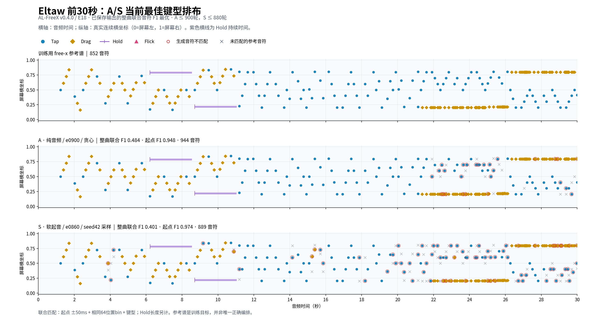

# E18 free-x：Eltaw 当前最佳排布对照

更新：1000轮训练结束后的最佳排布已更新为[A/S 980轮贪心对照图](freex_layout_e0980_20261026.md)。本页保留以下早期截止范围的历史结果。

2026-10-26。对象为 `AL-FreeX v0.4.0 / E18-A、E18-S`。范围冻结在A的20–900轮、S的20–880轮，每20轮的贪心与seed42原始输出，共178份。只复算已有生成结果，当前训练继续运行。

“最好”在这里指**Eltaw整曲训练谱的排布拟合**：只从自行结束的输出中，按起点时间＋64位置bin＋键型的联合音符F1取最高值。同分依次比较连续四组复现率、起点F1、末音误差和轮次。这是单首已见训练曲上的选择，不代表全部歌曲或可玩性排名；也不保证自行结束的输出覆盖完整尾段。

| 模型与输出 | 联合音符F1 | 起点F1@50ms | 网格分 | 连续四组复现率 | 末音相对参考 |
| --- | --- | --- | --- | --- | --- |
| A／e0900／贪心 | 0.4844 | 0.9482 | 0.6597 | 27.31% | 早20.9ms |
| S／e0860／seed42 | 0.4009 | 0.9736 | 0.6913 | 14.94% | 早12.5ms |

A/S允许各选既有解码方式，图上明确注明；没有重新搜索随机种子。这不是相同解码策略下的架构优劣对照。A参考匹配435/944个生成音符，S匹配349/889个；参考共852个音符。起点高分与排布拟合仍有明显差距。

[整曲概览PNG](assets/freex_layout_best_20261026/eltaw_full.png) · [整曲分段PDF（每页30秒）](assets/freex_layout_best_20261026/eltaw_full_detail.pdf) · [前奏PDF](assets/freex_layout_best_20261026/eltaw_intro.pdf)

横轴为音频秒，纵轴为屏幕实际连续横坐标：`x = 0.05 + 0.9 × (bin + residual) / 64`。点形与颜色区分Tap、Drag、Hold、Flick；紫色横线表示Hold持续时间。红圈是没有匹配到参考的生成音符，灰叉是没有匹配到生成的参考音符；不标记Hold长度差异，也不把参考以外的编排自动判为不可玩。

参考取自已核验SHA的全300首缓存，沿用free-x训练目标的时间、位置残差和Hold长度。原始855个音符在原数据处理中去掉3个同tick同位置重复项，保留852个；本次没有再次清洗。该参考是训练目标，不是编谱的唯一正确答案。

联合音符F1沿用原起点50ms一对一匹配，再在匹配组内要求相同位置bin和键型，分母包含全部参考和生成音符。连续四组复现要求四个参考组的bin×键型集合都一致且生成组连续；两者均不要求Hold长度一致。这是额外的拟合诊断，原benchmark及训练目标未改变。

匹配音符的连续横坐标平均绝对误差：A约屏宽0.0955%，S约0.1004%。仅在已经匹配起点、bin与键型的Hold中，持续长度MAE为A133.9ms（9个）、S194.3ms（12个）；这些条件误差不包含错位或遗漏音符。

[完整排名CSV](assets/freex_layout_best_20261026/ranking.csv) · [指标、输入与权重SHA](assets/freex_layout_best_20261026/summary.json) · [复算与绘图脚本](assets/freex_layout_best_20261026/analyze.py)。参考谱自匹配联合F1及连续四组复现率均为1，全部178份输出的复算起点F1与原评测一致；所选不可变权重及其源评测SHA已核验。
