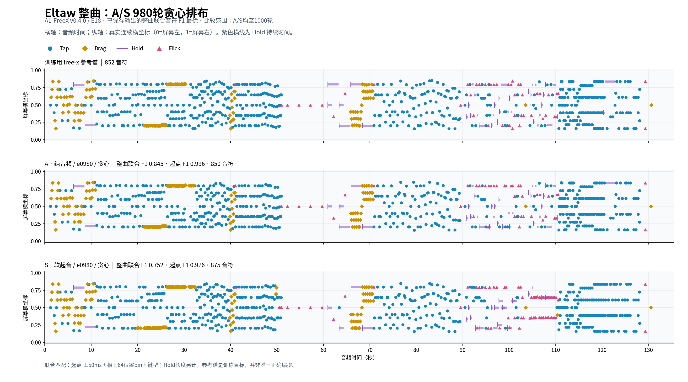
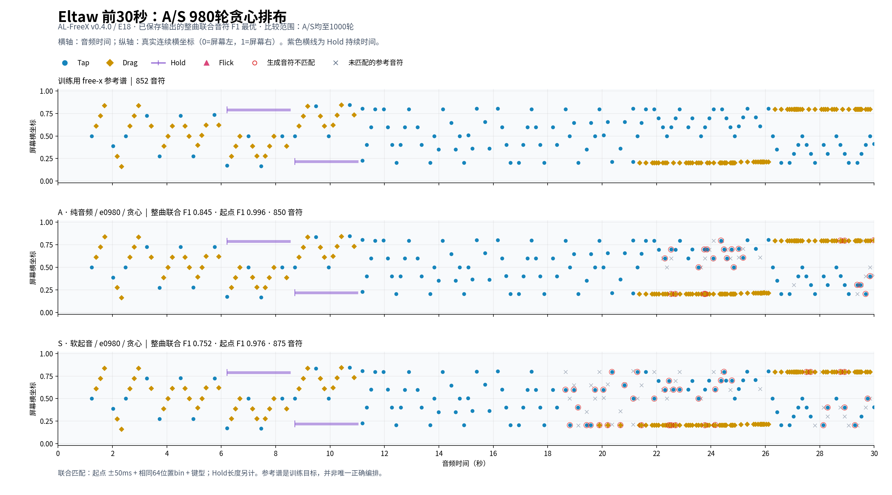

# E18 free-x：980轮贪心排布图

对象：`AL-FreeX v0.4.0 / E18-A、E18-S / e0980 / greedy`，曲目Eltaw。训练已完成1000轮。沿用此前选择口径，比较两组20–1000轮的贪心与seed42共200份已保存输出，仅在自行结束的输出中按整曲时间＋64位置bin＋键型联合F1选优；两组均选中980轮贪心。这是已见训练曲的拟合对照，不是新歌曲泛用性或可玩性排名。

| 模型 | 起点F1@50ms | 网格分 | 联合音符F1 | 连续四组复现率 | 匹配音符 / 生成音符 |
| --- | --- | --- | --- | --- | --- |
| A 纯音频 | 0.9958 | 0.7183 | 0.8449 | 68.28% | 719 / 850 |
| S 软起音 | 0.9762 | 0.6934 | 0.7516 | 58.18% | 649 / 875 |

参考共852个音符。从上到下为训练参考、A、S；横轴为音频时间，纵轴为实际连续屏幕横坐标，四种颜色/形状表示四种键型，紫色横线表示Hold长度。

前奏及分段图中的红圈表示未匹配的生成音符，灰叉表示未匹配的参考音符；联合匹配不包含Hold长度，也不将参考以外的编排自动判为不可玩。连续坐标按模型的bin＋residual实际反归一化值绘制，未做吸附或冲突修复。

[整曲分段PDF，每页30秒](assets/freex_layout_e0980_20261026/eltaw_full_detail.pdf) · [前奏PDF](assets/freex_layout_e0980_20261026/eltaw_intro.pdf) · [全部排名CSV](assets/freex_layout_e0980_20261026/ranking.csv) · [数据与SHA](assets/freex_layout_e0980_20261026/summary.json) · [复算绘图脚本](assets/freex_layout_e0980_20261026/analyze.py)

图中数值与[1000轮收尾核验](freex_anchored_20261025.md)一致；参考自匹配、全部200份起点F1复算、所选不可变权重与源评测SHA均通过检查。旧的[A900/S860排布图](freex_layout_best_20261026.md)继续保留作为历史对照。
