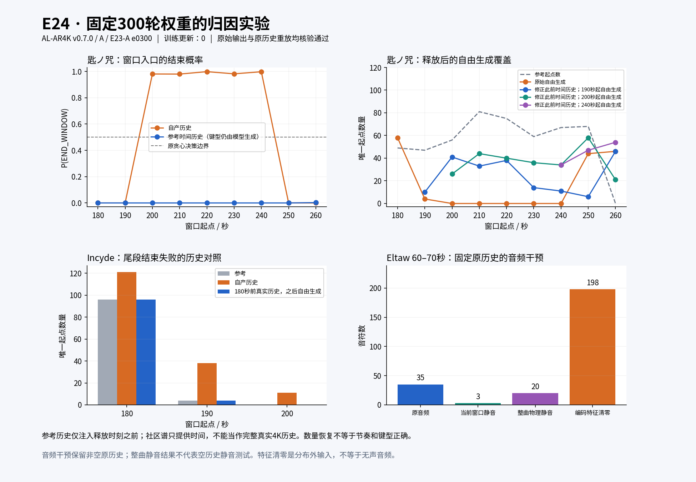

# E24：E23 第300轮的历史、音频与窗口结束归因

用户要求先做归因实验。本次固定 **AL-AR4K v0.7.0 / A / E23-A / e0300**，只做推理干预，训练更新为零。权重 SHA-256 为 `b1bfc4a3ba85f86b338f201204b3e9bd354349d3a8a4398b4db5d5b8aeefe17a`。实验于 11 月 4 日制定、11 月 5 日执行；S 继续暂停。

## 要区分的问题

当前网络每个出键组先预测 `p(END_WINDOW | 音频, 历史, 当前窗口)`；决定继续后，才预测窗口内下一起点及键型。全部音频一直可见，时间指针只能落在当前窗口。五个连续空窗可能来自五次错误的结束判断，不需要发生一次越过 50 秒的时间跳转。

E23 原评测中，匙ノ咒的 200–250 秒恰好包含五个在入口直接 END_WINDOW 的窗口。训练曲 Incyde 则在最后三个窗口不肯自主结束。这两类错误分别取证，不能以统一升降停止阈值掩盖。

## 固定案例与干预

| 案例 | 身份 | 检查窗口 | 用途 |
|---|---|---|---|
| Eltaw | 训练曲 | 60–70秒及最后窗口 | 已拟合的正对照 |
| Incyde | 训练曲 | 最后三个窗口 | 有真实4K历史的结束失败 |
| 天使にふれたよ!（40717） | 社区开发曲 | 170秒后 | 有缺音但能结束的对照 |
| 匙ノ咒（52417） | 社区开发曲 | 180秒后 | 连续空窗及窗口结束失败 |

- **原始复现**：原生成器加只读记录，音符和窗口记录必须与原 e300 逐项相同；再强制重放原历史，验证全部音符及释放后的自由窗口记录仍完全相同。被强制的历史窗口结束标记单列，不作为自主生成结果。
- **真实4K历史**：只用于训练曲，将窗口前的时间、键型、位置、时值换成训练标签；到窗口入口立即释放，后续全由模型生成。
- **参考时间历史**：社区谱没有对应的4K位置真值，只强制此前各组的参考起点及窗口转换，历史键型仍由模型生成。它检验时间历史的作用，不能称为完整真实谱面历史。
- **短 self-attention 历史**：在固定窗口入口重新计算最后64个 token 的注意力缓存，保留原绝对位置、时间、历史摘要和整曲音频。这是历史依赖诊断，不是产品修复。
- **当前摘要清零**：只将入口 token 的28维历史摘要清零，保留既有 self-attention 缓存。它不等于清除全部历史，也不等于“历史权重归零”。
- **音频对照**：固定同一原生历史，分别输入重新编码的整曲物理静音、仅当前10秒静音、编码特征清零；时间长度、有效帧、窗口和参考 BPM 保持相同。特征清零是分布外敏感性测试，不能当作物理静音。重新编码会影响整个全局音频及前缀隐藏状态。

只对释放之后的窗口计算起点匹配、数量和结束；强制前缀不计入改善，参考未来键型不作为输入。真实历史下的结束分类仅为条件诊断，不代替自主生成成功率。四首是按已知现象选取的案例，不是随机抽样或盲测。

所有对照保持原贪心解码和12,000 token预算，没有网格吸附或补键规则。复用原 Mel 与权重，不保存新模型；磁盘、RAM至少各保留8 GiB，RSS上限6 GiB，GPU分配上限65%。

四首全部对照已完成。实验配置见[固定计划](assets/joint_attribution_20261104/plan.json)，复现代码见[diagnose.py](assets/joint_attribution_20261104/diagnose.py)，逐窗指标见[汇总](assets/joint_attribution_20261104/summary.json)，全部决策记录见[无损压缩JSON](assets/joint_attribution_20261104/results.json.gz)。原始生成谱面仅保存在 `out/joint_attribution_20261104`，不提交Git。

校验修订：最后一首的原历史含强制窗口边界。注入相同历史 token 时，该边界会被诊断脚本显式触发，因而前缀记录可能从“强制边界”变为“自主结束”；全部音符仍完全相同。修订只将窗口记录比较限定到释放后的部分，并记录前缀差异，未改变生成算法或干预。前三首结果原样保留其来源哈希；[原计划](assets/joint_attribution_20261104/plan_initial.json)和[修订内容及源码差异](assets/joint_attribution_20261104/validation_amendment.json)均已留档。

## 训练曲：结束失败受生成历史影响

Eltaw 与 Incyde 的原输出及原历史重放均逐项复现。完整真实历史下，Eltaw 的701次继续、14次结束，以及 Incyde 的1390次继续、21次结束，均被停止头正确分类。这是已见歌曲上的条件诊断，不是新歌泛化成绩。

只将 Incyde 的180秒前历史换成真实4K谱，180秒起恢复完全自由生成，得到：

| 窗口 | 参考起点 | 原生生成起点 | 换入此前真实历史后 | 原生／修正前缀后结束 |
|---|---:|---:|---:|---|
| 180–190秒 | 96 | 121 | 96（F1=1） | 强制／自主 |
| 190–200秒 | 4 | 38 | 4（F1=1） | 强制／自主 |
| 200–200.584秒 | 0 | 11 | 0 | 强制／自主 |

200秒空窗入口，原历史下停止概率约 `2.04e-7`；修正180秒前历史后，模型自由生成到200秒时为 `0.9932`。声学输入和网络参数相同，说明历史干预足以修复该案例；不能把这里的失败简单归为“停止头从未学会结束”。此干预同时改变历史时间、键型和位置，尚未进一步隔离三者的贡献。

同一 Incyde 若只重算最后64个 token 的注意力历史，尾部仍三个窗口强制结束；只清零180秒入口的历史摘要虽变成全部自主结束，却在190–200秒生成109个起点（参考只有4个，F1=0.0354）。因此，“能结束”与“生成正确”必须分开，截历史或清摘要不能据此直接成为产品修复。

Eltaw 60–70秒原输出35音符；此前真实历史替换后仍35音符、起点F1=1。固定原历史后，该10秒物理静音输出3音符，整曲物理静音输出20音符，编码特征清零输出198音符。声学干预明显改变输出，排除了这一案例中“模型完全不使用音频”的解释；清零编码特征与物理静音不是等价条件。这里刻意保留了此前非空谱面历史，尚不能将20音符推广为“从空历史开始的静音音频也会这样生成”。

## 社区曲：连续空窗被历史放大，恢复后仍有条件泛化错误

匙ノ咒的原始轨迹为：190.2766秒后指针跳到193.5577秒，接着停止头以0.5922结束190–200秒窗口。200/210/220/230/240秒五个入口的停止概率依次为0.9806/0.9799/0.9982/0.9818/0.9976，各输出零个音符。这里每个入口都看得到整曲音频，且当前窗口的时间范围有效；不是五个窗口都没有可用音频区间。

将200秒以前换为“参考时序＋模型自产键型”的历史，200秒起全部自由生成：

| 窗口起点 | 参考起点数 | 原生起点数 | 修正前缀后起点数 | 修正前缀后F1@50ms |
|---|---:|---:|---:|---:|
| 200秒 | 56 | 0 | 26 | 0.5366 |
| 210秒 | 81 | 0 | 44 | 0.4000 |
| 220秒 | 75 | 0 | 40 | 0.3826 |
| 230秒 | 59 | 0 | 36 | 0.2316 |
| 240秒 | 67 | 0 | 34 | 0.4752 |

这五个窗口恢复了180个唯一起点，按各窗分别匹配共命中104/338个参考起点；仍有大量漏音。只有第一个窗口自主结束，随后四个需要强制边界。原来五个空窗也都标记 `learned_end_window`，所以该标记只说明网络发出了结束动作，不证明结束时机正确或谱面覆盖合格。

另在190秒、240秒分别释放参考时序前缀，空白区也恢复出音，但结束和匹配仍不稳定。持续喂入参考时序时，200–240秒的入口停止概率降至约 `4.3e-10`–`1.2e-8`；然而193.72秒仍有一次0.9969的错误提前结束倾向，231.13秒还有一次0.6287。190–250秒共有385次参考继续决策，原时间指针选中参考所在物理音频帧的仅203次（52.7%，是约46.44ms帧的命中率，**不是起点F1**）。这说明改正时间历史能消除空窗连锁，但并未使新歌条件映射全部正确。

两个历史通道均会影响空窗入口：仅重算最后64个 token 的 self-attention 缓存，200秒入口停止概率从0.9806降至约 `3.03e-5`；仅清零该入口的28维摘要，则降至0.00366。两者都恢复出音，但此前训练曲对照已显示它们会带来其他退化，不能据此认定应该整体“加强”或“削弱”历史。

天使にふれたよ! 的170–180秒参考为13个起点：原生生成56个、匹配2个；参考时序前缀修正后生成97个、匹配11个，F1从0.0580升至0.2000，仍有大量额外输出，最后窗口还从自主结束变为强制结束。社区谱没有完整4K位置真值，这些实验不能进一步排除自产键型历史的影响，也不能单独判定音频编码器或谱面解码器谁应承担全部错误。

## 下一步建议：先验证恢复训练，再分离结束判断

优先做同一 e300 初始状态、相同步数的两组训练对照：原配方继续训练，或加入“自产前窗历史→真实当前窗口”的续写任务。两组都保留整曲音频可见、当前窗口输出、A全参数训练及原有四键型。新增组仅在窗口边界换入模型实际生成的历史，当前窗标签仍按绝对时间定义，避免把错误生成的第 i 个 token 硬配给参考第 i 个 token；强制前缀和辅助参考信息不进入独立生成评测。

应覆盖实际出现的漏组、额外组、错误键型及连续空窗历史，不只重复±20ms抖动。此前[H1小扰动实验](windowed_ar_stage3_20261031.md)没有稳定改善恢复表现，不能当作这一方案已经被验证。全曲参考音符只是编谱的一种实现，训练和评分仍需同时查看音乐对应、额外出音、段落覆盖及结束，不要求自然音乐逐声学音符配键。

如果恢复训练仍无法解决参考时序条件下的过早／过晚结束，再独立比较窗口剩余事件的声学监督和结束损失；显式时长、剩余时间、末窗标志也应单列对照。当前证据尚不能证明单加音频结束标记就能解决问题，更不能把两种干预一次全部叠加后宣称完成归因。本轮未进行这些训练或结构修改。

## 核验、资源与对照图

四首原生复现均与 e300 音符及窗口记录完全一致；四首原历史重放均保持所有音符及释放后的窗口记录完全一致。所评分的续写决策均未被强制，前缀不含释放时刻之后的谱面标签。权重与冻结推理源码哈希核验通过，诊断脚本通过编译检查；没有产品或训练逻辑改动。

最终磁盘剩余26.08 GiB，可用RAM37.49 GiB；各曲收尾采样的RSS最高1.83 GiB，GPU峰值已分配0.205 GiB、保留0.260 GiB。没有新权重或Mel缓存副本，约4.1 MiB的决策JSON无损压缩至0.36 MiB归档。

[PDF](assets/joint_attribution_20261104/attribution.pdf) · [绘图及汇总代码](assets/joint_attribution_20261104/summarize.py)。曲线里的参考时序条件诊断与自由生成续写分别标注；音符数量恢复不代表时间、类型、位置或可玩性已通过。
