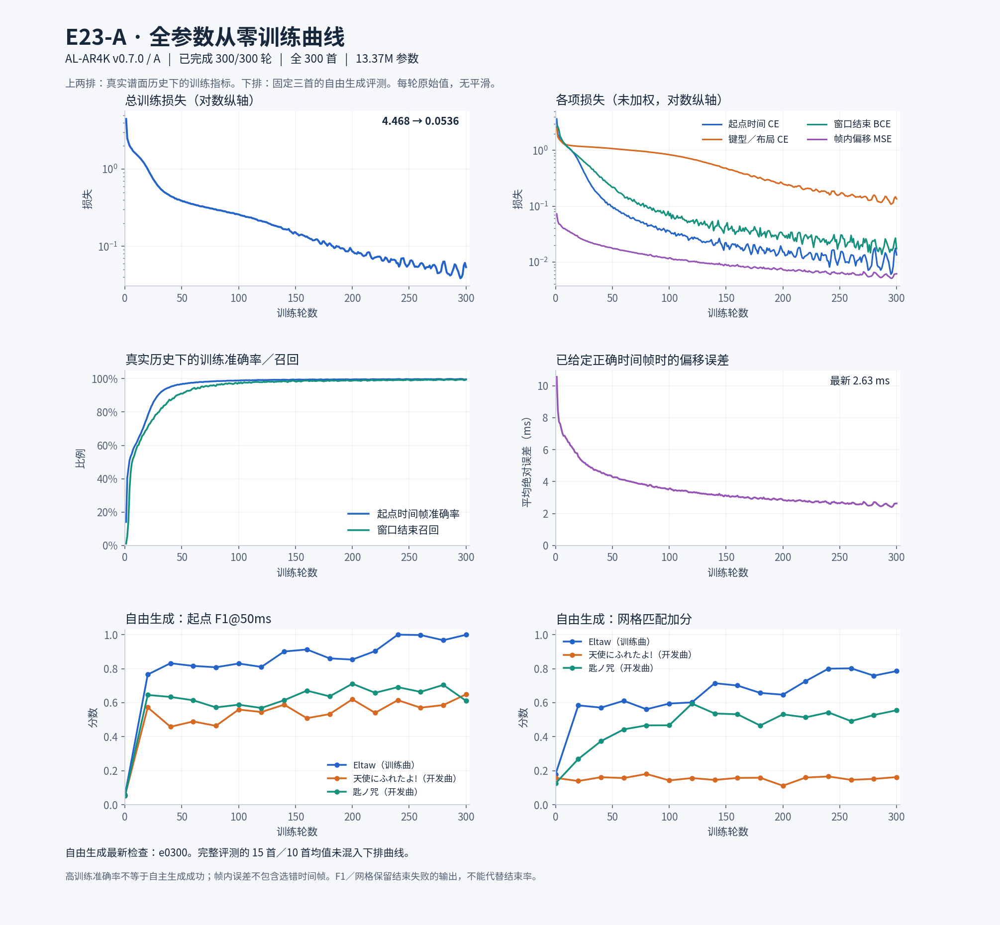

# E23-A：完整音频编码器与分窗解码器从零训练

用户要求重新从随机初始化开始。本实验为 **AL-AR4K v0.7.0 / A / E23-A**，保持 E22 的 1337 万参数结构，但音频编码器、谱面解码器、优化器与随机采样状态全部重新初始化。不是从 A1400、分窗 e100 或联合微调 e20 续训。S 继续暂停。

## 初始化与数据边界

`--initialization scratch` 分支只读取[结构 JSON](assets/joint_audio_scratch_20261102/architecture.json)，不调用 `torch.load` 读取任何父权重；配置中 `parent`、`frontend`、`parent_epoch` 均为空，`inherited_parameter_tensors=0`。随机种子 42；采用各模块标准初始化，LayerNorm 的一/零、窗口及历史投影的默认零初始化属于结构定义，不来自旧模型。

卷积层、六层音频 self-attention、memory 投影、全部谱面 self/cross-attention 与时间/键型/位置/结束头都可训练。模型仍随时读取整曲音频，只输出当前 10 秒窗口的音符。纯 A 没有独立起音网络，不读取冻结神经特征作为输入。

只读复用 `out/joint_audio_a_20261102/mel`：全部 300 首的固定 log-Mel、两份原物理裁切、真实静音和原标签，缓存总计 1.438 GiB。共享目录必须已经完整且通过 SHA 校验，不再复制；每一步从 Mel 重新计算当前网络特征。

## 训练安排

- 目标 300 轮、90,000 次更新；不使用微调的 `3e-6` 小学习率。编码器和解码器均以 `3e-4` 为目标学习率，前 1500 步线性 warmup，随后保持恒定；每组都是正学习率。
- AdamW 初始状态为空。每轮保存完整模型、优化器和 RNG，仅保留 latest 与 best-fit。300 轮是首个观察预算，是否充分由拟合与自由生成曲线判断。
- e0 只测 Eltaw 与两首缺音曲，记录随机起点；每 20 轮测同三首，第 100/200/300 轮测固定 15 首训练曲＋10 首社区开发曲。新歌仍为开发回归集，不冒充盲测。
- 指标保持起点 F1、网格加分、时间＋类型 F1、训练集位置联合分、窗口结束、段落缺音与 Hold 覆盖。四种键型完整保留，网格仍只作评价，不强制吸附。
- 继续采用 RSS 6 GiB、RAM/磁盘至少保留 8 GiB、GPU 65% 分配上限与激活重算。网络容量、窗口协议、数据及损失不变；学习率和初始化改变，所以本轮回答从零训练能力，不是严格的单变量冻结消融。

## 启动验证

51 项测试通过，含禁止初始化读取权重文件、相同 seed 可复现、不同 seed 同时改变音频/谱面参数、空 AdamW 状态、warmup 在恢复时按绝对步数计算，以及旧 4K/free-x 的兼容检查。

真实 GPU 检查覆盖 Eltaw、最长音频 Drop It、最长谱面「祈 -我ら神祖と共に歩む者なり-」。全部 279 个参数张量都有有限梯度且实际变化，各音频层均有非零梯度。探针更新全部丢弃，正式训练重新创建同一 seed 的初始网络。资源峰值约 RSS 1.92 GiB、GPU 已分配 0.371 GiB；不是所有歌曲或服务端资源认证。

独立后台任务已启动，先运行三首随机基线，再自动训练。完整配置见[配置与初始化指纹](assets/joint_audio_scratch_20261102/config.json)，梯度见[真实整曲证据](assets/joint_audio_scratch_20261102/gradient_probe.json)。实时状态：`out/joint_audio_scratch_20261102/training.json`，日志：`worker.log`；此时尚无训练后质量结论。

上一组 E22 联合微调已完整结束 20 轮，权重和报告作为对照保留，见[E22 最终结果](joint_audio_a_20261102.md)。不替换已发布模型包。

## 第177轮曲线快照

用户请求训练曲线，已冻结到完整 e177：总损失 4.4681→0.1070，训练帧内条件 MAE 约 2.95 ms；这是给定正确历史和正确时间帧的指标，不是自由生成起点误差。图使用每轮原始值，没有平滑。

[PDF](assets/joint_audio_scratch_20261102/curves_e0177/training_curves.pdf) · [训练 CSV](assets/joint_audio_scratch_20261102/curves_e0177/training.csv) · [生成评测 CSV](assets/joint_audio_scratch_20261102/curves_e0177/evaluation.csv) · [快照与来源](assets/joint_audio_scratch_20261102/curves_e0177/provenance.json)。

下排始终是 Eltaw、天使、匙三首独立曲线，不把第100轮的15首训练曲/10首开发曲均值混入。最新生成检查为 e160：Eltaw F1@50ms 0.9129、网格0.7010并正常结束；天使0.5089/0.1578、仍有3个强制窗口；匙0.6710/0.5319、仍有10个强制窗口，最长参考有音空档约7.60秒。F1及网格保留了结束失败的输出，不能代替成功率或可玩性。这是阶段快照，300轮训练仍按原计划继续。

## 300轮最终结果

2026-11-03 05:17（悉尼）正常完成 300 轮、90,000 次更新及最终 25 首评测，训练进程已退出。模型身份为 **AL-AR4K v0.7.0 / A / E23-A / e0300**；训练代码提交 `9a7f38f`。续跑权重 `out/joint_audio_scratch_20261102/model_latest.pt` 的 SHA-256 已核验：`b1bfc4a3ba85f86b338f201204b3e9bd354349d3a8a4398b4db5d5b8aeefe17a`。

| 轮数 | 固定评测集合 | 起点 F1@50ms | 网格加分 | 时间＋键型 F1 | 所有窗口正常结束 |
|---|---|---:|---:|---:|---:|
| 100 | 训练 15 首 | 0.7820 | 0.5661 | 0.4114 | 3/15 |
| 200 | 训练 15 首 | 0.8865 | 0.6417 | 0.6198 | 11/15 |
| 300 | 训练 15 首 | 0.9641 | 0.6879 | 0.8843 | 14/15 |
| 100 | 社区开发 10 首 | 0.5888 | 0.1886 | 0.3249 | 1/10 |
| 200 | 社区开发 10 首 | 0.6399 | 0.1868 | 0.3471 | 2/10 |
| 300 | 社区开发 10 首 | 0.6407 | 0.1844 | 0.3520 | 3/10 |

均为自由生成评测，含结束失败时已输出的音符。“正常结束”要求每个窗口自主输出 END_WINDOW；调度器走完整首音乐不等于模型学会整曲 EOS。社区曲已反复用于开发，不是盲测；社区时间＋键型 F1 不比较动态判定线几何。网格只作匹配加分，没有强制吸附。原始字段 `completed_only_joint_f1_50ms` 是将失败谱计零后对全体求均值，不是仅对成功谱求均值；本表没有使用该字段。

Eltaw 的起点 F1 达到 **0.9993**、网格 **0.7858**、时间＋键型 F1 **0.9923**、时间＋位置＋键型 F1 **0.9876**，全部窗口自主结束。训练曲仅 Incyde 仍有 3 个强制结束窗口。开发曲天使にふれたよ! 的 F1 为 0.6490，全部窗口自主结束；匙ノ咒为 0.6110，仍有 3 个强制窗口，193.56–250.10 秒没有输出音符，该段参考谱有 370 个起点。此处缺音诊断不要求模型逐音符复制参考，但长段空白仍需检查。

训练总损失从 e200 的 0.0855 降至 0.0536，键型布局 CE 从 0.2503 降至 0.1350。真实历史下的帧定位准确率为 99.604%，窗口结束召回为 99.434%；这些指标不能替代上表的自由生成成功率。训练曲继续改善，开发曲 F1 在最后 100 轮只增加 0.00084，网格略降，说明拟合收益尚未转化为稳定泛化。匙ノ咒的最长参考有音空档也从 e280 的 9.66 秒增至 56.54 秒，不能把改善描述为单调稳定，更不能仅凭这些数据确定是过拟合、编码器或历史依赖中的哪一个原因。

下一项候选对照是显式提供音频总时长、剩余时间、归一化进度与末窗标志，同时比较真实历史和生成历史下的窗口结束行为；尚未实现，不混入这次基线。S 继续暂停，本轮未自动追加训练或替换已发布权重。

最终资源记录：RSS 2.07 GiB、GPU 峰值已分配 0.475 GiB／保留 0.898 GiB，剩余磁盘 26.55 GiB、可用 RAM 37.21 GiB。保留 latest 和 best-fit；未复制 Mel 缓存。这是本次训练记录，不是产品服务显存需求认证。

[PDF](assets/joint_audio_scratch_20261102/curves_e0300/training_curves.pdf) · [训练 CSV](assets/joint_audio_scratch_20261102/curves_e0300/training.csv) · [生成评测 CSV](assets/joint_audio_scratch_20261102/curves_e0300/evaluation.csv) · [快照与来源](assets/joint_audio_scratch_20261102/curves_e0300/provenance.json) · [最终结果与逐曲指标](assets/joint_audio_scratch_20261102/final_result.json)。
