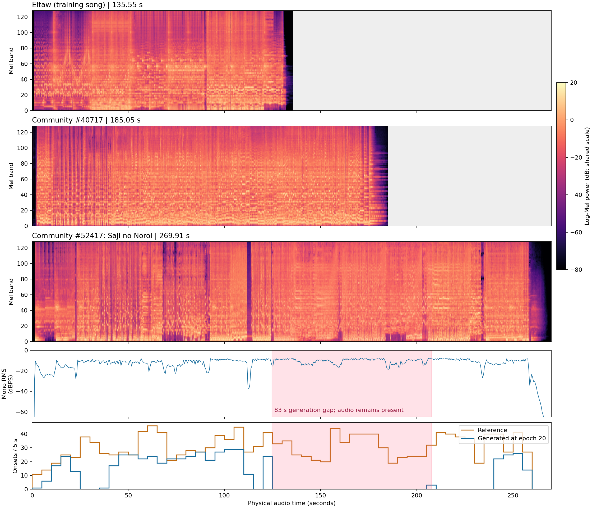

# E28：《匙ノ咒》的Mel与长空段诊断

结论：encoder支持变长，203秒不是硬上限。没有发现该曲Mel缓存损坏或缺音区间实际静音；直接观察到的是时间指针将远处时刻打成最高概率，跨过中间音频。长度、历史与时间坐标的贡献尚未单独分离，不能仅因歌曲较长就归因给encoder。

本轮只读分析既有300首训练Mel、10首开发Mel以及第20轮输出；另在空闲GPU 1上固定读取一份**AL-Event4K v0.3.0/e0041**做三组推理。没有训练更新、模型结构修改或新权重副本，GPU 0上的300轮计划继续。第20轮权重已随滚动快照更新，保留了当时输出；第41轮对照不冒充第20轮精确复跑。

## 编码长度与频谱检查

当前链路为`128×T_mel → 卷积/池化 → T_audio=T_mel/2 → 全曲音频self-attention`。时间维由实际音频决定，RoPE根据实际长度生成；谱面decoder再读取完整音频memory，没有固定203秒截断或固定长度的位置表。

| 曲目 | 音频长度 | 音频token数 | Mel重算与缓存 |
| --- | ---: | ---: | --- |
| Eltaw | 135.55秒 | 2919 | 完全一致 |
| 天使にふれたよ! | 185.05秒 | 3985 | 完全一致 |
| 匙ノ咒 | 269.91秒 | 5812 | 完全一致 |

三首均从原音频重新计算Mel，逐元素最大误差为0，音频和缓存文件SHA符合原清单。300首训练曲的长度中位数143.01秒、95分位173.84秒、最长202.89秒（4369个音频token）。因此《匙ノ咒》的长度超出训练样本覆盖，但网络能够处理，且这本身不是因果结论。

300首训练Mel和10首开发Mel全部数值有限。《匙ノ咒》的Mel均值、标准差分别位于训练曲分布的40.7%、58.7%位置；不是明显的整体数值异常。它的频谱时间变化较强：逐帧正向log-Mel差分的95分位为5.407，处于训练曲约90.3%分位，仍有约一成训练曲更强。这是频谱变化统计，不是学习式起音准确率。

第20轮主要空段是**124.770–207.693秒**。这段原音频0.5秒RMS的中位数为**−9.55 dBFS**，前段为−11.26 dBFS；空段内没有低于−60 dBFS的0.5秒检查块，也没有全部Mel频带处于数值下限的帧。−60 dBFS仅用于检查静音，没有进入网络或解码阈值。

图中灰色是超出该首音频长度的画布留白，**不是补成270秒送入encoder**。粉色标示第20轮空段；第三排Mel及下面RMS仍有明显信号，最下排生成起点却为空。

## 同一份第41轮权重的对照

三组均贪心生成、相同BPM=174、同一套权重；裁剪真实波形后重新计算Mel。共同比较原曲125–200秒，参考有452个唯一起点。

| 输入 | 共同区间生成起点 | 共同区间F1@50ms | 整份输入最大空段 | 结束状态 |
| --- | ---: | ---: | ---: | --- |
| 完整269.91秒 | 16 | 0.0641 | 83.63秒 | 自主EOS |
| 只取前200秒 | 131 | 0.3739 | 83.59秒 | 音频边界强制截断 |
| 取120秒之后，重新从0开始，共149.91秒 | 408 | 0.7698 | 27.40秒 | 自主EOS |

前200秒已在训练长度范围内，仍出现**35.134→118.725秒**的83.59秒跳跃，所以不能将问题解释为超过203秒后模型才失效。后段单独输入能恢复大量起点，也说明同一段声学内容并非必然生成空白。但裁剪同时改变总长、可见未来音频、时间原点及历史，不能凭此断言长度或历史哪一个是唯一原因。

完整曲目的最大跳跃为**140.966→224.594秒**。在这一步，时间头给224.583秒所在候选帧的概率为**96.96%**，接下来5秒的候选概率总和只有**1.91%**，EOS概率约`1.09e-12`。这次空段由选择远处时间造成，没有生成窗口结束，也不是提前EOS。单调时间约束使跳过之后无法回填，空段因此保留下来。

前200秒输入的83.59秒跳跃也给远处候选99.78%的概率。两次远跳都约1800个音频帧，值得继续检查时间表示的远距混淆；目前没有分离位置编码、声学特征与历史的干预证据，不能据此宣称RoPE存在固定83.6秒周期或实现错误。

## 解释边界与下一步

“只有这一首有问题”也不准确：第20轮当前只测了三首，《天使にふれたよ!》在34.03–40.20秒也有6.17秒空段，参考有23个起点。《匙ノ咒》的问题更严重，尚未用这一版本对全部10首做同等诊断。

当前证据支持优先查下一事件的时间定位及其与历史的耦合。后续要固定同一权重、相同音频和前缀，分别改变时间坐标或历史，才可区分时间表示、音频编码和历史误差的贡献。本轮没有据此更改正在训练的结构或加入固定窗口。

验证：三首原音频Mel逐元素复现；所有310份整曲Mel有限；三组同权重推理均完成诊断并保留失败状态。诊断GPU峰值分配0.166GiB、保留0.217GiB，RSS约1.67GiB；结束后训练仍运行，磁盘约剩25.80GiB。没有复制音频、Mel缓存或checkpoint。

[Mel统计](assets/saji_mel_20261105/mel_audit.json) · [推理对照、概率与权重SHA](assets/saji_mel_20261105/controls.json) · [复现脚本](assets/saji_mel_20261105/diagnose.py)。完整逐步轨迹保存在`out/saji_mel_20261105`；脚本读取时固定同一文件句柄，训练原子替换best权重不会改变该次对照的模型。未额外保留第41轮权重，未来运行脚本需重新记录实际读取的epoch及SHA，不能默认视作第41轮复现。
