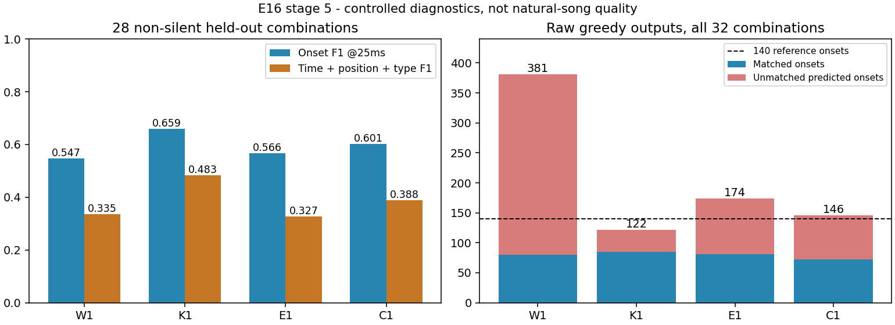

# 第 5 阶段：键型、音频适配、容量与模式续写

三项独立对照及两组模式训练均完成 400 轮。生成任务每组 12,800 次更新；模式任务每组 16,000 次更新。这是构造数据上的架构归因，没有把 32 条诊断训练写成全 300 首自然歌曲训练。

本阶段最明确的收益来自 K1 条件键型头，主要是减少自由滚动的过量输出。现有解码器已能根据明确前缀续写模式；自然歌曲中的模式选择与维持仍需验证。已接续[全 300 首的同父权重 W0/W1 适配](windowed_ar_natural_20261031.md)，先隔离协议收益，再判断是否加入 K1。

## 模型修改与控制条件

| 运行 | 改动 | 参数 |
| --- | --- | ---: |
| W1 | 原联合 NOTE 输出，冻结音频编码器，复用第 2 阶段完整对照 | 6,692,227 |
| K1 | 条件输出 p(action) p(type\|NOTE) p(position\|type,NOTE) | 6,723,836 |
| E1 | 仅解冻最后一个全局双向音频 block 与末端 LayerNorm | 7,482,563 |
| C1 | 解码器宽度 256→512，深度 6、头数 8 不变 | 25,966,851 |

各组全曲原分辨率音频、10 秒输出责任窗、完整因果历史、四键型、多押及 Hold 表示不变。没有起音阈值、硬节拍吸附或键型比例配额。K1 分解输出概率，输入 token 流保持不变；不是原先 factorized 输入嵌入开关。E1 缓存的是末层之前的全曲激活，末层每步实际重算并接收谱面梯度。69 条样本的末层重建及原半精度缓存误差均为零。编码器 LR 3e-5，其余 3e-4，使用相同 5% warmup/cosine。

小模型共享部分使用相同随机初始化；C1 张量尺寸改变，只保证 seed、数据、曝光与调度相同。统一评第 400 轮，未按随机检查集挑轮数。W1 在物理区间浮点修复前训练，但固定数据的目标帧索引全部不变。

## 自由成谱结果

起点为非静音样本的宏平均 F1@25ms；联合要求时间、位置与类型一致，失败整谱记零。新组合为 32 条中的 28 条有音样本；固定探针的虚构类型和位置从不评分。

| 运行 | 训练起点 / 联合 | 新组合起点 | 新组合联合 | 新组合结束 | 固定起点 | 新组合网格加分 |
| --- | --- | ---: | ---: | --- | ---: | ---: |
| W1 | 1.0000 / 1.0000 | 0.5472 | 0.3352 | 29/32 | 0.3500 | 0.2366 |
| K1 | 1.0000 / 1.0000 | 0.6592 | 0.4830 | 32/32 | 0.6726 | 0.2364 |
| E1 | 1.0000 / 1.0000 | 0.5664 | 0.3268 | 31/32 | 0.6667 | 0.2150 |
| C1 | 1.0000 / 1.0000 | 0.6011 | 0.3876 | 32/32 | 0.5417 | 0.2344 |

网格只加分，不决定输出排布。调度器走完整曲不代表学会整曲 EOS；结束要求每窗均由模型 END_WINDOW 结束。

此构造任务随机选择 tick，不要求排在偏好的网格位置上；新组合参考谱自身的网格均值为 **0.2024**。因此这里的约 0.23 不能与自然音乐训练曲的约 0.7 直接比较。

| 运行 | 新组合有参考却为空的窗口 | 静音额外起点（训练/新组合/固定） | 训练秒数 | 显存峰值 GiB |
| --- | --- | --- | ---: | ---: |
| W1 | 5/51 | 0/0/0 | 789.6 | 0.143 |
| K1 | 2/51 | 0/0/0 | 759.2 | 0.143 |
| E1 | 2/51 | 0/0/0 | 829.4 | 0.154 |
| C1 | 6/51 | 0/0/0 | 765.6 | 0.510 |

## 明确前缀的模式续写

输入 24 个给定起点，每个一个 Tap；前 8 个谱面位置可见，自回归续写后 16 个。同一音频有五种不同模式；模型没有模式 ID 或未来位置提示。训练/新组合各 40 条、各 8 段共享音频；新组合使用未入训的轨道排列。没有输出周期约束，跨窗仍保留完整历史。该任务检验位置续写，不能据此声称时间、密度、类型选择已经解决。

家族名 `staircase` 的代码含义是四个位置按指定顺序循环，包含非单调排列；原训练/新组合中严格的左右循环楼梯分别只有 4/2 条。不能把全部 8 种排列都称为标准楼梯。另补测全部起始轨道与左右方向的标准循环，见后续附加检查。

附加检查固定为四轨每次向左或向右一轨、到边界后循环，4 个起点 × 2 个方向 × 8 段未入训音频，共 64 条。P0/P1 均为 **64/64 段全部正确、1,024/1,024 个后续位置正确**；时间和前缀仍然给定，没有新增训练。[严格楼梯检查与完整输出](assets/windowed_ar_20261031/standard_stairs.json)。

| 任务 | P0 联合头：位置 / 整段正确 | P1 条件头：位置 / 整段正确 |
| --- | --- | --- |
| train | 1.0000 / 40/40 | 1.0000 / 40/40 |
| train/jack | 1.0000 / 8/8 | 1.0000 / 8/8 |
| train/short_jacks | 1.0000 / 8/8 | 1.0000 / 8/8 |
| train/long_jacks | 1.0000 / 8/8 | 1.0000 / 8/8 |
| train/alternation | 1.0000 / 8/8 | 1.0000 / 8/8 |
| train/staircase | 1.0000 / 8/8 | 1.0000 / 8/8 |
| new_combinations | 1.0000 / 40/40 | 1.0000 / 40/40 |
| new_combinations/jack | 1.0000 / 8/8 | 1.0000 / 8/8 |
| new_combinations/short_jacks | 1.0000 / 8/8 | 1.0000 / 8/8 |
| new_combinations/long_jacks | 1.0000 / 8/8 | 1.0000 / 8/8 |
| new_combinations/alternation | 1.0000 / 8/8 | 1.0000 / 8/8 |
| new_combinations/staircase | 1.0000 / 8/8 | 1.0000 / 8/8 |

## 归因边界

新组合共 140 个参考起点。W1/K1/E1/C1 分别输出 381/122/174/146 个，匹配 80/85/81/72 个；K1 的收益主要是更少的错误输出及更稳定的结束。K1 的真实历史下“继续＋下一时间正确”只有 60/140，低于 W1 的 69/140，不能把自由生成 F1 提升泛化为单次定位全面改善。E1 相应计数为 73/140，但自由生成联合 F1 没有提高，说明单步定位和滚动排布须分开看。K1 还包含位置条件 MLP；本轮没有单独拆分概率分解与这层非线性的贡献。

P0 推理干预进一步检查了模式续写的来源，训练更新为零：

| 干预 | 训练后缀位置正确率 | 新组合正确率 | 新组合整段正确 |
| --- | ---: | ---: | ---: |
| 原模型 | 100% | 100% | 40/40 |
| 清零手工历史摘要，保留 token 历史 | 100% | 100% | 40/40 |
| self-attention 只保留当前 token，摘要保留 | 22.34% | 17.66% | 0/40 |
| 两者都移除 | 26.72% | 16.88% | 0/40 |

这支持当前模型在该任务中使用历史 token 完成续写。干预改变了推理分布，不能替代“从零训练无摘要模型”的比较，也不证明摘要在训练期间毫无作用。[完整干预输出](assets/windowed_ar_20261031/pattern_context_dependence.json)、[共用初始化与编码器真实参数更新核验](assets/windowed_ar_20261031/stage5_initialization_audit.json)。

清零音频特征的损失变化及真实历史下的时间/停止/排布计数见原始汇总。清零特征测依赖性，真正静音另外使用静音波形；两者不能互换。若训练集拟合但新组合仍差，不能把“结构能记住”当“已学会泛化编谱”；若给定时间与前缀的模式能续写，只说明当前 self-attention 可以利用该模式历史，不能自动推导无前缀自然生成也有同样能力。

[完整数据、参数、checkpoint/source SHA256、资源与诊断](assets/windowed_ar_20261031/stage5_result.json)。
以上均为单 seed、有限构造分布。自然歌曲全量训练与缺音回归仍须单独执行；产品权重不自动替换。

资源表是小规模缓存特征实验，CPU 调度开销占比较高；C1 用时接近小模型，不代表全曲计算成本接近。C1 的本轮显存峰值约为 W1 的 3.6 倍，服务端整曲与 8GB 显卡仍须单独测量。
