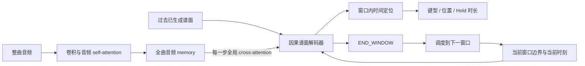

# 长训后优化决策：整曲音频可见，当前窗口出谱

2026-10-30。汇总加训前 E16 计划、Mapperatorinator 代码参考、1400 轮训练及 E20 新歌诊断。**用户已明确下一版结构要求：模型每一步能看到整曲音频，但只生成当前窗口的音符。** 本文完成方案整理；尚未实施新结构、训练或替换发布权重。

建议暂停追加完全相同配方的训练，优先验证**全局音频条件下的分窗输出协议**，再单独加入历史时间纠错训练。先用 4K A 建立对照，验证后移植到 free-x；A/S 保持独立。键型表示、编码器适配和扩容分别后置。原定长 diffusion 计划继续保留为独立对照，不因本轮选择 AR 主线而删除。

## 1. 加训前计划保留什么，哪些已经完成

原文：[定长音频生成归因计划／E16](fixed_length_attribution_plan.md)、[Mapperatorinator 架构参考](mapperatorinator_architecture_review_20261025.md)、[迁入的讨论记录](AudioLab_chart_generation_context_2026-10-25.md)。历史决策原样保留，以下是当前状态。

| 原计划 | 已完成的证据 | 尚未完成／下一步用途 |
| --- | --- | --- |
| 从固定 10 秒、静音和单起音开始，明确物理时间与编解码 | 时基/codec 已有专项；三音、弱音、重复音、跨边界探针已固定 | 随机单音小样本定位器、逐级课程未执行；旧探针在长训后仍未通过，不能跳过基础检查 |
| 分清声学起音 O、谱面起点 S、键型排布 B | A/S 独立权重，S 使用连续软起音；E14/E18 有独立时间头 | 复杂音乐不能逐声学音符配键；起音不是必出键条件，取音与排布需分别评价 |
| 定长张量直接 diffusion，先不经过 VAE | 三月模型复现与历史时轴归因已完成 | 同时钟、同数据的直接 diffusion／VAE 隔离对照未执行，不能把旧模型成绩当作公平架构比较 |
| 测历史使用、重复/模进与模式续写 | 已有历史摘要、完整因果 self-attention；free-x 的已预测 residual 已进入后续历史 | 无摘要重训、历史扰动、受控模式任务、MTP/FIM 均未执行；不能把“加入历史”写成“已学会编排” |
| 允许过拟合，先检验原模型是否训练不足 | 四组已完成 1400 轮；固定训练曲拟合明显提高 | 充分拟合部分已见歌曲，不等于已测出架构能力上限或泛化合格 |

原计划中“32 个样本先拟合→扩展随机组合→复杂编谱→整曲”的顺序仍有价值。基础任务规定数量是受控测试合约，不能推广成自然音乐的音符数量配额。旧 DT 模型的全 Tap、没有独立时间监督等历史问题，不能直接套到当前 E14/E18；它们已经增加绝对时间 pointer、独立停止头和联合整曲/片段/静音训练。

## 2. 长训回答了什么

以下使用 E20 测试前冻结的同四份候选；free-x A 为 e1300，其余为 e1400。训练侧是固定 **15 首已见歌曲**，新歌侧为 **10 首社区歌曲**，不是全 300 首成谱质量认证。F1 均为唯一起点 ±50 ms；两侧网格沿用同一加分规则，各自使用参考时基。

| 候选 | 训练曲起点 F1 | 训练曲网格 | 训练曲自然结束 | 新歌起点 F1 | 新歌网格 | 新歌自然结束 |
| --- | --- | --- | --- | --- | --- | --- |
| AL-AR4K v0.5.1 / A1400 | 0.9997 | 0.7045 | 15/15 | 0.4745 | 0.1763 | 3/10 |
| AL-AR4K v0.5.1 / S1400 | 0.9987 | 0.7045 | 15/15 | 0.3881 | 0.1746 | 3/10 |
| AL-FreeX v0.4.0 / A1300 | 0.9191 | 0.6609 | 14/15 | 0.4567 | 0.1720 | 3/10 |
| AL-FreeX v0.4.0 / S1400 | 0.9617 | 0.6647 | 14/15 | 0.4770 | 0.1728 | 4/10 |

4K 的训练曲时间＋位置＋键型联合 F1 也达到 A/S 0.9921/0.9893，说明当前约 6.63M 参数的模型能拟合这些训练谱；不能再把所有失败统称为“没训够”。但最后阶段损失仍下降，free-x A 1400 又比 1300 回退，说明损失下降与自由生成改善不是同一件事。S 在新歌上没有跨玩法一致收益，尚不足以合并或删除 A/S 路线。

新歌参考谱平均网格为 0.9121；不能拿 ±50 ms 起点匹配代替更精细的节奏对齐。新歌“时间＋键型 F1”没有位置要求，也不能与训练曲的含位置联合 F1 直接比较。自动估速没有参与 E20，这批失效不能归咎于用户没填 BPM。

证据：[1400 轮收尾](evaluations/ar_continue1400_20261028.md)、[新歌评估](evaluations/phira_generalization10_20261029.md)、[精确数值与来源](evaluations/assets/optimization_review_20261030/evidence.json)。三月 diffusion 的优势仅在旧比较范围内成立；其音频输入覆盖约 95.1 秒、谱面轴约 190.2 秒等混杂仍需隔离，详见[历史归因](evaluations/diffusion_ar_attribution_20261023.md)。

## 3. 当前问题：确认的机制与待验证的解释

| 问题 | 已确认事实 | 不能直接下的结论 | 优先级 |
| --- | --- | --- | --- |
| 下一事件跨过整段音乐 | pointer 对全部未来有效帧分类；89.885→253.372 秒大跳给出 91% 概率，跳后不能回填 | 不是音频为空、导出漏音；不等于 cross-attention 或 AR 本身不适用 | 最高：限定输出责任区间 |
| 结束与覆盖不稳定 | 新歌仅 13/40 自然结束；大跳时停止概率很低，尾端停止失败是另一个问题 | 正常结束或音频末尾截断不代表整曲覆盖 | 同时建立窗口结束与覆盖评价 |
| 生成历史影响时间定位 | 缩短 self-attention 历史后，8 个大跳中 3 个回到下一秒内，其他仍有问题 | 不能据此认定摘要有害、历史越少越好，或应统一调低历史权重 | 第二：合法的历史扰动/恢复训练 |
| 停止监督稀疏 | e1400 每轮停止标签 1200 个，继续标签 4K 270200、free-x 273769；当前按事件总数归一化 | 约 1:225/228 的比例是风险证据，不是停止失败的单因素归因；真实历史停止召回已很高 | 分窗后仍失败才单独比较损失归一化 |
| 排布与模式泛化弱 | 新歌出现重复单一位置、缺少段落呼应；当前位置×键型联合 NOTE 输出，实际配置未启用 factorized 输入嵌入 | 贪心 Tap 多不能证明应提高/降低某个历史权重；不能用键型比例验收 | 时间稳定后做属性/模式实验 |
| 声学特征是否足够 | 音频有 self-attention，缺音处特征非零、有限、有效；短段独立生成能出键 | 不等于前端已理解音乐，清零特征敏感也不等于听懂；冻结前端可能存在限制 | 轻量定位探测先行，解冻后置 |
| 容量与数据范围 | 4K 可训练 6,626,691，free-x 6,815,860；原 300 首全参加训练 | 未做容量对照，不能说 6M 必然不够，也不能凭训练拟合判定数据足够泛化 | 协议稳定后分别扩数据/容量 |

当前损失在真实历史下预测真实下一帧；帧 CE 会惩罚错误，但在真实帧概率相同时，不区分错误质量集中在近邻还是两分钟后。当前还没有在模型自身错误历史上监督漏段恢复。大跨度跳转的实际后果因输出时间不可逆而放大。[八份精确回放及上下文对照](evaluations/phira_gap_diagnosis_20261030.md)。

## 4. Mapperatorinator 值得借鉴的部分

继续以固定提交 `0e2b0e387aab4b35c64b0b11b12d47578dea7587` 的 V32 为准，本次复核关键代码；没有下载权重、运行质量横评或改动本地旧副本。

| 上游做法 | 对本项目的价值 | 采用方式与边界 |
| --- | --- | --- |
| 音频窗口、回看上下文与前瞻，窗口调度控制新增范围 | 避免把任意整曲跨度都交给一次下一时间分类 | 借鉴输出调度；我们的音频 memory 始终保留整曲，不照搬其局部音频输入 |
| 先生成干净 labels，再扰动输入 TIME_SHIFT；V32 offset=2 | 在轻微错误历史下继续定位正确目标 | 从约 ±20 ms 的组级时钟扰动开始；重算全部时间输入和摘要，确保真值仍合法 |
| 独立事件属性、玩法/难度条件 | 分离类型、位置、时长的责任，表达同曲多种编排 | 在时间问题改善后单独对照输出属性分解；可靠难度标签建立后再加入，不使用 Hold 配额 |
| 音频编码器参与主任务优化，模型规模更大 | 编排任务可适配音频表示 | 先测冻结特征可读性，再分别比较解冻末层和增大解码器；不同时改两项 |
| 节拍吸附与坐标扩散等独立模块 | 说明最终效果可能包含后处理与额外模型 | 原始与后处理成绩分开；不把 V32 主干误写成 U-Net 扩散整谱，也不照搬 resnap |

原始证据：[窗口参数](https://github.com/OliBomby/Mapperatorinator/blob/0e2b0e387aab4b35c64b0b11b12d47578dea7587/config.py#L54-L55)、[窗口推理](https://github.com/OliBomby/Mapperatorinator/blob/0e2b0e387aab4b35c64b0b11b12d47578dea7587/osuT5/osuT5/inference/processor.py)、[时间屏蔽](https://github.com/OliBomby/Mapperatorinator/blob/0e2b0e387aab4b35c64b0b11b12d47578dea7587/osuT5/osuT5/inference/logit_processors.py)、[历史扰动](https://github.com/OliBomby/Mapperatorinator/blob/0e2b0e387aab4b35c64b0b11b12d47578dea7587/osuT5/osuT5/dataset/data_utils.py#L606-L680)、[V32 训练配置](https://github.com/OliBomby/Mapperatorinator/blob/0e2b0e387aab4b35c64b0b11b12d47578dea7587/configs/train/v32.yaml)。窗口结束是工程协议，不证明自主整曲 EOS 学习成功；小幅时间扰动也不自动修复百秒漏段。

## 5. 用户确认的主结构：输入全局，输出分窗

设整曲时长为 T，波形 X，经原编码器得到全曲连续特征 H。输出责任区间为 `I_b=[s_b,e_b)`，依次覆盖 `[0,T)`；首轮建议 W=10 秒，与原 E16 定长任务对齐，**10 秒是待验证实验参数，不是用户已指定数值**。窗口以物理时间定义，不吸附拍点。

联合分布可以写为：

`p(Y|X,c) = ∏_b p(Y_b | H, Y_<b, s_b,e_b,c)`。

区间内部继续自回归生成同刻音符组；时间候选满足 `max(s_b,上一组时间+ε) ≤ t_i < e_b`，四键型/多押/位置/持续由模型预测。这里 c 代表实际提供的玩法与节拍条件；当前没有可靠风格/难度条件就不能假装已经使用。

| 变量 | 结构职责 |
| --- | --- |
| H／全部音频时刻 τ_j | 每个生成 token 都可 cross-attend 全部有效帧；首轮不改为仅局部音频或压缩的远处摘要 |
| 当前生成时刻 t_i | 音乐时间编码；供网络在全曲音频中定位，不能只靠序列 token 序号 |
| s_b,e_b | 显式窗口边界条件，同时定义时间头合法输出区间；不用于遮罩音频 cross-attention |
| Y_<b 及本窗已生成组 | 因果 self-attention 和现有历史摘要；首轮不同时截短历史或删除摘要 |
| END_WINDOW | 当前窗口没有更多待生成组；空窗也合法，然后进入下一个相邻窗口 |
| Hold 的起点/终点 | 按起点归属唯一窗口；结束时间允许跨窗，完整时长只导出一次，持续状态传给后续窗口 |

时间分组和窗口必须按半开区间归属，边界音符只生成一次。长休止可以连续生成空窗，不强制每窗有键；调度不会因为空窗而跳过尚未检查的后续窗口。长 Hold 不切成多个音符，也不因跨窗截短。

首轮通过保留过去的完整 Hold token/时长和生成状态跨窗延续，不同时新增一套手工历史摘要；若另测显式活跃 Hold embedding，应单列表示实验。

**输出区间限制是明确的生成协议约束，必须同时用于标签编码、训练和推理。** 不能只给旧权重推理临时加 mask，就称完成了新结构训练。它保证一次时间选择不能跳出当前窗口，但仍可能发生过早 END_WINDOW、连续空窗和漏音；这些必须另外验证。走完整个音频是调度器的性质，不再冒充模型自主预测全曲 EOS 的成绩。

第一轮维持全曲原分辨率 memory 与完整过去谱面，避免同时换音频压缩和历史范围。后续若需降低资源，可另评全局压缩表示；不能静默替换用户本次确认的全曲可见条件。可学习相对时间注意力偏置也是独立后续实验，当前时刻之外的音频不应被硬遮掉。

## 6. 实验顺序与失败时怎么走

下列为 E16 的待执行子实验，不是已经训练的新产品版本。暂不为每项创建新的长期分支或发布权重。

| 顺序 | 实验 | 固定与改变 | 进入下一步的依据 |
| --- | --- | --- | --- |
| D0 | 定长基础与表示检查 | 32 个随机位置/音色/音量的受控片段；现有冻结特征＋轻量定位头，加入长休止、同音重复、边界及跨窗 Hold | codec 往返不丢事件；能拟合小样本，固定未入训探针通过；失败时先查标签/特征，不开大训练 |
| W0/W1 | 原整曲输出 vs 当前窗口输出 | 首批只做 4K A；共同主干同随机初始化，前端、数据、键型表示、采样不变；改变输出协议及其必要的边界条件/结束标签 | 小样本自由生成通过，再使用全 300 首；比较整曲漏段、窗口漏段、误出音与边界问题 |
| H0/H1 | 干净历史 vs 轻微错误历史训练 | 在通过的协议上比较；保留正确音频与目标，仅扰动输入历史时间并重算摘要 | 受扰历史下恢复提高，正常输入不退化，不能仅看训练 CE |
| F | free-x 对应实现 | 在 `feature/freeform-gameplay` 独立训练与报告；保持 64 bin＋连续 residual，单独检查空间/长条跨窗 | 时间收益能复现，坐标和多押不因跨窗破坏；S 使用独立权重复验成功方案 |
| K | 键型属性与模式 | 独立比较联合 NOTE、类型→位置串行输出或条件多头；一次只测一个替代表示 | 受控短纵/交互/楼梯和自然重复段有可验证改善，非追齐类型比例 |
| E/C | 编码器与容量 | 先冻结/解冻末层，再当前约 6–7M／约 20–30M 解码器；使用相同数据与任务 | 改善新歌曲及音频干预响应，不能只提高训练拟合；参数范围仅为实验候选 |

W0/W1 的“一个因素”是完整分窗输出协议，包含边界条件、候选域和 END_WINDOW 监督，不会把其收益进一步冒称为仅由 mask 带来。两组从共同初始化开始，旧 e1400 作为已测行为参照，不拿新模型 10 轮的成绩直接归因于结构优劣。

全部 300 首仍可用于主训练；同一参考音符在一首曲目的窗口集合里只监督一次。记录原始事件曝光数、优化器更新数、额外边界 token 数及 GPU 小时，不能只用相同 epoch 宣称预算公平。先用单 seed 筛查实现与方向，关键胜出结论再补独立 seed。尚未拟合的小试只能叫小试，不能宣布架构能力不足；超过阶段预算而未收敛时如实记录，不以继续堆轮数替代失败归因。

H1 建议从组级 ±20 ms 扰动开始，同刻和弦共享扰动；保序、保持目标在合法时间域、保留完整 Hold。时间嵌入和所有依赖时钟的历史字段一致更新，不能偷偷保留另一份精确历史。扰动会跨过下一真实目标时，缩小或重采样并报告比例，不能把不可达真值继续当下一标签。它解决小误差恢复，不宣称覆盖任意漏组/百秒跳转。

若要训练真实生成错误的恢复，须另立“块内草稿→整块重建”或有明确定义的合法续写任务；不能把生成序号 i 直接对上参考序号 i。无需更强教师，GKD 仍不开展。MTP 可作后续模式辅助；FIM/双向修谱需要明确草稿/后段来源，不能在独立生成评测时偷看参考未来谱面。

如果 W1 仍大量提前结束窗口，下一项只比较窗口结束的监督/归一化；如果时间定位仍偏，比较物理时间误差目标或相对时间偏置；如果能定位但模式弱，进入 K。辅助覆盖目标若启用，应预测参考编谱在区间中的事件存在性，配合真实空区间，不把音量或所有声学起音当出键标签。这些目标不与 W1 同时加入。

## 7. 直接验收，防止靠约束或加键获得假改善

以下是拟冻结的内部推进标准，不是对外产品准确率承诺；正式实验开始前把固定名单、数值与分母写入 manifest。

| 检查 | 通过依据 |
| --- | --- |
| 时间/表示 | 对可表示事件往返误差 <1 ms，数量/类型/位置不丢；已有 codec 碰撞单列，禁止默默去重；窗口边界不重复、不漏、Hold 不截断 |
| 受控定位 | 扩展随机探针 P/R@25ms 均 ≥99%；原三音/弱音/重复/跨界样例满足既有合约；真静音误出音 0；长休止后的事件仍可恢复 |
| 大段缺音 | 固定八处诊断区间不再整段空白，八处最长缺音的中位数至少较旧候选下降 50%；同时报告各区间全部输出、起点 P/R、密度及听看结果，单纯塞入一个键不能过关 |
| 新歌对应 | E20 同口径起点 P/R/F1、25/50/100 ms 误差与未匹配比例；候选平均 F1 不较对应冻结候选降低超过 0.02，且缺音改善；网格仅作加分展示，不设硬网格及格率 |
| 结束/覆盖 | 分别报调度遍历率、模型 END_WINDOW 正常结束率、提前空窗、末段覆盖及 token 预算截断；不把调度结束与旧的自然 EOS 混为同一成绩 |
| 模式/几何 | 明确前缀的受控模式续写；自然重复/模进段的排布对照；4K 轨道、free-x 实际连续坐标分别评价；不以 Hold 占比或默认双指上限验收 |
| 实际体验 | 对改善和回退片段做音频同步对照，最终 Phira 手机/平板试玩；模型原始输出和任何可选修复独立报告 |

E20 十首已用于分析、选方向，后续只能称开发回归集，不再当盲测。当前按曲名/原音频 SHA 查重未覆盖跨转码或变速版本；最终候选应另冻结未用于调参的歌曲，做更可靠音源去重，并保持全部 300 首训练的既有约定。

## 8. diffusion、资产与资源安排

E16 原定长 diffusion 路线保留：先做同一 10 秒目标与前端的定位基线、直接事件张量 diffusion，检查同格事件碰撞及可逆表示，再单独引入 VAE。若 AR 分窗仍难以形成稳定键型模式，用相同物理时轴、数据曝光与计时比较块内联合生成。三月权重只读保留，旧时轴优点/问题不混入新基线；不用复杂音频逐音符复刻作为唯一音乐质量标准。

当前不优先做更大模型、调高起音阈值、类型配额、全谱吸附、N-best 堆采样、无偏好依据的 DPO/RL 或动态表演。先把时间覆盖与编排行为做成可归因的模型能力。

4K 和 free-x 的实现分别进入原模型分支，共享时基/数据协议独立提交，经 develop 集成；main 与 B03/B04 发布权重不自动替换。A/S 继续独立，首批只用 A 降低实验组合数量；版本在实际实施时登记，计划不冒充新模型。

本次仅整理文档。当前磁盘约 8.17 GiB，距 8 GiB 保护线仅约 0.17 GiB，不能直接排新训练。启动前按既有清理授权列清单核验，保留父断点、发布包与关键候选；可用空间必须高于 8 GiB 加本轮保存峰值估算。复用全曲缓存，不下载 Mapperatorinator 权重或复制音频。训练资源继续采用已有保护；另一台 8GB 显卡的整曲服务推理须另做实测，不能以训练诊断峰值替代产品验收。
